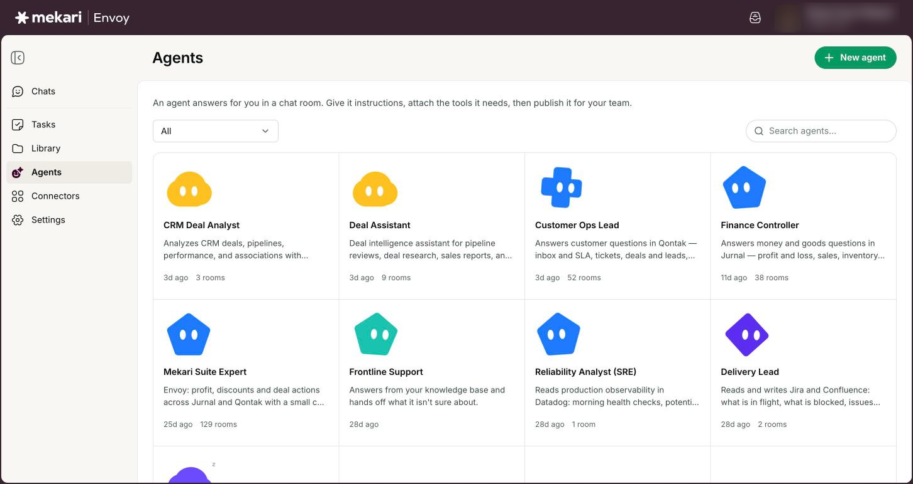
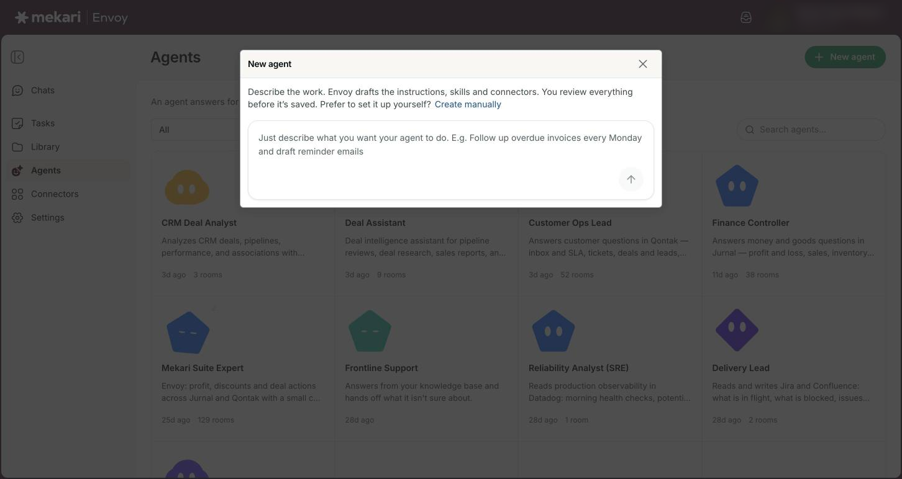
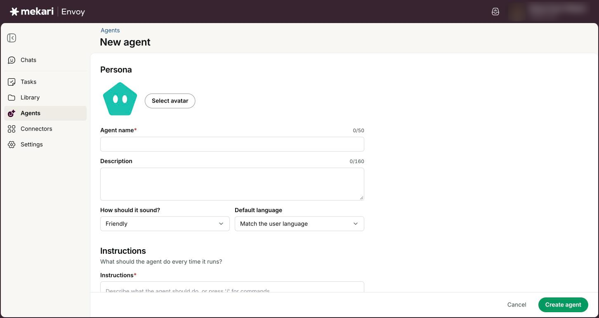
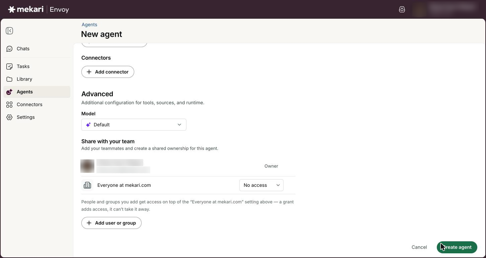
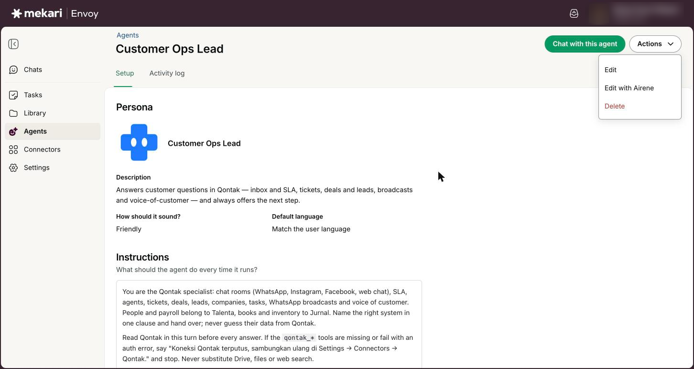

# Agents


**General Guide** — for everyone, no technical knowledge needed.


| | |
|---|---|
| **Who this is for** | Everyone who uses Envoy; creating and editing needs the Member or Admin role |
| **Where to find it** | **Agents** in the left rail |
| **Last checked** | 24 October 2026 |

## What it is

An agent answers for you in a chat room. Give it instructions, attach the tools it needs, then publish it for your team. Think of it as a specialist: a sales follow-up helper, an HR policy explainer, or an invoice chaser.

You can describe the agent in a sentence and let Envoy draft it for you, or fill in the setup yourself. Either way you review everything before the agent is created, and you can share it with teammates when it is ready.

## Before you start

* You need the **Member** or **Admin** role to create or edit agents. Viewers can open agents and read their setup.
* If the agent should use an app, connect that app first on the **Connectors** page (see [Connectors (connect your apps)](../guides/connectors.md)), or connect it from the agent's **Add connector** window.
* If the agent should answer from your own files, put them in a collection in the knowledge base first (**Settings**, then **Knowledge base**; see [Knowledge base](../guides/knowledge-base.md)). Agents read collections, not single files.

## How to use it

### Browse and chat with agents

1. Click **Agents** in the left rail.
2. Use the status filter to show **All**, **Draft**, **Published**, **Private** or **Off** agents.
3. Type in **Search agents…** and press Enter to find an agent by name.
4. Click **Chat** on an agent's card to start a chat with it, or click the card to open its details.
5. On an agent's details page, click **Chat with this agent**.

<figure><figcaption>
The Agents page
</figcaption></figure>

### Create an agent by describing it

1. Click **New agent** (or **Create your first agent** if you have none yet).
2. Describe the work in the box, for example "Follow up overdue invoices every Monday and draft reminder emails". Envoy drafts the instructions, skills and connectors.
3. Press Enter and wait while **Building your agent…** shows.
4. Review the draft that opens. Change anything you like.
5. Click **Create agent**.


Your draft is saved as you go (you see **Saving draft…** then **Saved**), so you can leave and come back. Click **Delete** to throw a draft away. Drafting uses your company's AI budget like a chat message.


<figure><figcaption>
Describing a new agent
</figcaption></figure>

### Create an agent manually

1. Click **New agent**, then click **Create manually**.
2. Under **Persona**, click **Select avatar** and pick a look, then fill in **Agent name** and **Description**.
3. Choose **How should it sound?** and **Default language**.
4. Write the **Instructions**: what the agent should do every time it runs. Include the tone and the reply language here too, for example "Always reply in Bahasa Indonesia, in a friendly tone."
5. Add skills, knowledge and connectors under **Tools and access** (see the next section).
6. Click **Create agent**.

<figure><figcaption>
Creating an agent manually
</figcaption></figure>

### Give the agent skills, knowledge and connectors

1. Under **Skills**, switch on each skill the agent should use. For example, switch on **image-reader** if people will send it pictures.
2. Under **Knowledge base**, click **Add collection or file** and tick the collections the agent needs in the **Add knowledge** window.
3. Under **Connectors**, click **Add connector**. Pick a connector on the left, read what it can do under **Tools**, switch it on (or click **Connect** first), then click **Add**.
4. Click the minus button next to any item to remove it.


Attach collections, not single files: a file attached on its own is not read by the agent. Leave **Use all company-wide files** off; it is not saved with the agent yet, so it gives the agent no extra files. The **Add knowledge** window lists up to 100 collections and 100 files.


<figure><figcaption>
Choosing knowledge for an agent
</figcaption></figure>

### Share the agent with your team

1. Open the agent and click **Actions**, then **Edit**.
2. Scroll to **Advanced**, then **Share with your team**.
3. Next to **Everyone at** your company, choose **No access**, **Can view** or **Can edit**.
4. Click **Add user or group** to give specific people or groups **Can view** or **Can edit**.
5. Click **Save changes**.


People and groups you add get access on top of the company setting. A grant adds access; it can never take it away.


<figure><figcaption>
Sharing an agent with your team
</figcaption></figure>

### Edit, review activity, or delete an agent

1. Open the agent. Click **Actions**, then **Edit** to change the setup, and click **Save changes** when you are done.
2. Or click **Actions**, then **Edit with Airene**. Tell Airene what to change in the chat panel, then click **Apply changes** on the card it shows you. Edit with Airene can change the name, description, instructions, tone and language only; use **Edit** for skills, knowledge and connectors.
3. Click the **Activity log** tab to see the agent's conversations, how many turns went well, the cost and when it was last used.
4. To remove the agent, click **Actions**, then **Delete**, and confirm.


A deleted agent cannot be restored, and its chat rooms are removed from your chat list.


<figure><figcaption>
An agent's Actions menu
</figcaption></figure>

## Your options

| Option | What it does |
|---|---|
| **Draft**, **Published**, **Private**, **Off** | A **Draft** is still being set up and cannot be chatted with yet; only its owner sees it. **Published** and **Private** agents are both ready to use; Published ones have also been published by their owner. An **Off** agent is switched off and cannot be chatted with. |
| **Agent name** | Required, up to 50 characters, and must be unique in your company. |
| **Description** | Up to 160 characters. It is shown on the agent's card and as the line under the greeting when someone starts a chat with it. |
| **How should it sound?** | The agent's tone: **Friendly**, **Professional** or **Concise**. It is saved and shown on the agent's page, but for now it does not change the replies, so also write the tone in **Instructions**. |
| **Default language** | **Match the user language**, **English** or **Bahasa Indonesia**. Like the tone, it is saved but does not change the replies yet, so write the language in **Instructions** too. |
| **Instructions** | Required, up to 32,000 characters. Write what the agent should do and how, including its tone and language. Headings and lists format as you type, and pressing / offers headings, lists and quotes. |
| **Model** | Under **Advanced**. Leave it on **Default** unless you need a specific AI model. |
| **Can view** / **Can edit** | Can view lets people use the agent. Can edit also lets them change its setup, but only the owner or a company admin can change who has access. |

## Good to know

* An agent you create is yours. You, your company's admins, and anyone you give **Can edit** can change it.
* Every company starts with three ready-made agents: **Datadog Expert**, **Google Cloud Cost Expert** and **Atlassian Expert**. Each works only once its app is connected, and company admins can change them. A deleted one can come back later.
* Your company can have up to 50 agents, and drafts count toward that number. Drafts are never removed for you.
* If you try to leave a live agent with unsaved changes, Envoy asks **Leave this page?**: click **Keep editing** to stay or **Leave** to drop your changes. If the tab closed before you saved, you see **Restore changes** or **Discard** next time you open the agent.
* An agent only uses the skills you switch on for it. Airene's everyday skills, such as reading images, are not added to an agent automatically.
* An agent can only use a Google product, such as Gmail or Google Calendar, if the person chatting has connected it themselves. The agent never gets more access than that person.
* Agents in **Off** or **Draft** status do not show a **Chat** button.

## Ideas to try

* Click **New agent** and type: "Answer staff questions about our leave and reimbursement policy, using only the HR handbook."
* Build an agent that drafts polite payment reminders from your Qontak deals, and write "Reply in formal Bahasa Indonesia" in its **Instructions**.
* Share a finished agent with your team as **Can view**, and give one colleague **Can edit** so they can help improve it.

## If something goes wrong

| What you see | What to do |
|---|---|
| "You must fill in a name" or "Name already taken" | Give the agent a name, and make sure no other agent in your company already uses it. |
| "Add instructions so the agent knows what to do." | Write at least a few lines in **Instructions**, then click **Create agent** or **Save changes** again. |
| "Agent limit reached (50)." | Your company already has 50 agents, drafts included. Delete agents or drafts you no longer need, then try again. |
| "This agent was changed somewhere else. Reload to get the latest version." | Someone else saved the agent while you were editing. Reload the page, then make your change again. |
| "This draft was changed in another tab" | Click **Reload** to get the latest version before you keep editing. |
| "Couldn't finish the draft. Try again, or set it up manually." | Describe the agent again in different words, or click **Create manually** and fill in the setup yourself. If your company's monthly AI budget is used up, drafting cannot run until it resets. |
| "Only the owner can change who can access this agent." | You can edit this agent but not its sharing. Ask the agent's owner or a company admin to change who has access. |
| You can click **Edit** on a colleague's agent, but saving fails. | Members see **Edit** on every agent, but only the owner, a company admin, or someone given **Can edit** can save changes. Ask the owner to share it with you as **Can edit**. |
| The agent does not use the tone or language you picked. | **How should it sound?** and **Default language** do not change replies yet. Write the tone and language in **Instructions**, then click **Save changes**. |
| The agent does not find a file you attached. | Single files are not read. Put the file in a collection in the knowledge base (see [Knowledge base](../guides/knowledge-base.md)), attach that collection under **Knowledge base**, and save. |

## Related guides

* [Chatting with Airene](../guides/chatting-with-airene.md)
* [Connectors (connect your apps)](../guides/connectors.md)
* [Knowledge base](../guides/knowledge-base.md)
* [Skills](../guides/skills.md)
