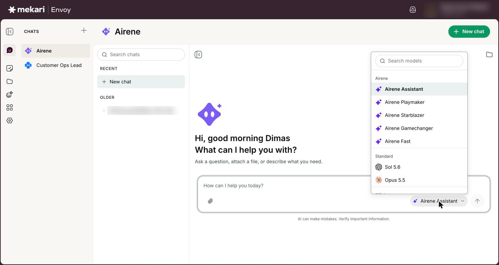
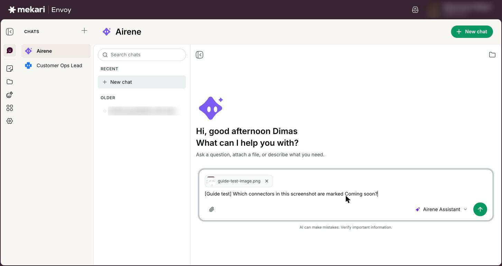
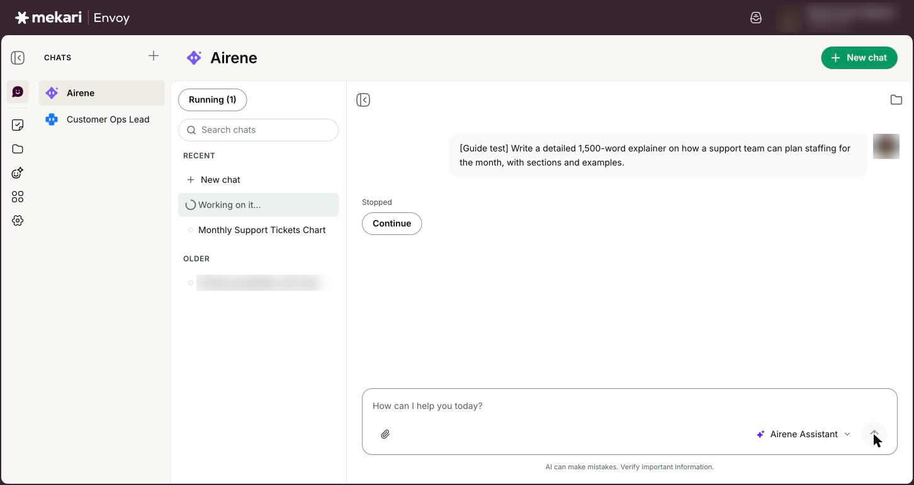
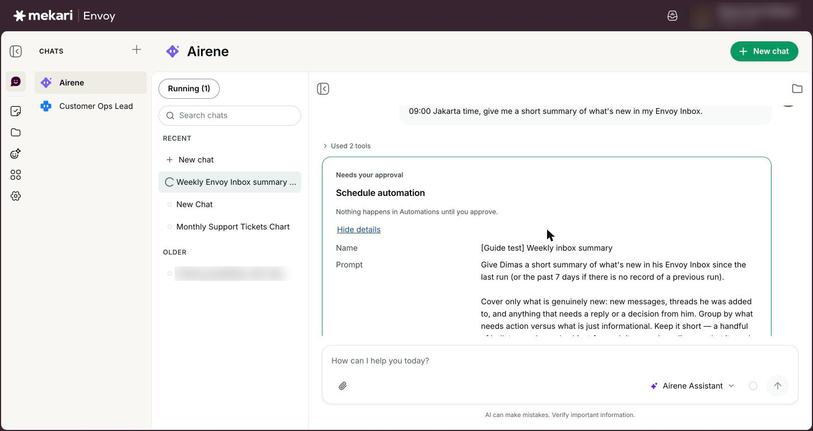
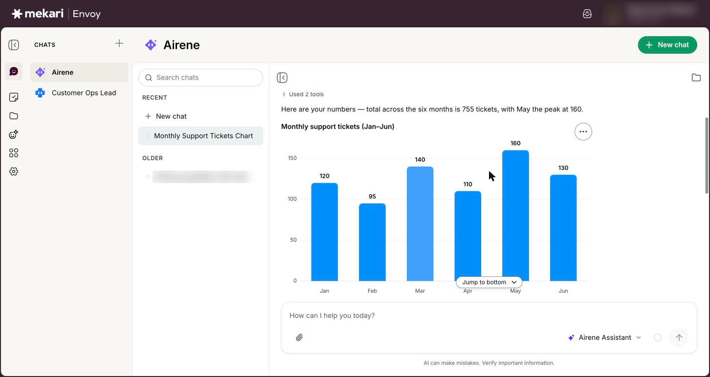
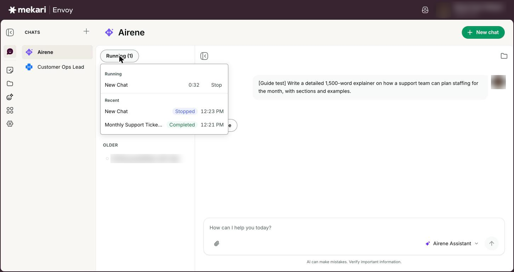

# Chatting with Airene


**General Guide** — for everyone, no technical knowledge needed.


| | |
|---|---|
| **Who this is for** | Everyone who uses Envoy |
| **Where to find it** | **Chats** in the left rail |
| **Last checked** | 24 October 2026 |

## What it is

Airene is Envoy's built-in assistant. You ask in plain words and Airene answers, looks things up, reads images you attach, draws charts and tables, makes files, and uses the apps you have connected.

Each conversation is a chat. Your chats are saved, so you can come back to them, search them, rename them or delete them. You can also chat with one of your team's agents instead of Airene (see [Agents](../guides/agents.md)).

## Before you start

* Sign in to Envoy (see [Getting started](../guides/getting-started.md)).
* Optional: connect apps such as Google Calendar or Qontak on the **Connectors** page (see [Connectors (connect your apps)](../guides/connectors.md)), so Airene can work with your own data and offer the **Daily routine** shortcuts.

## How to use it

### Start a new chat

1. Click **Chats** in the left rail, then pick **Airene** in the Chats panel.
2. Click **New chat** at the top of the page or at the top of the **Recent** list, or click the Mekari Envoy logo.
3. Type your request in the box that says **How can I help you today?**
4. Press Enter or click **Send**. Press Shift+Enter to add a new line instead.
5. Or, in a new chat, click a shortcut under **Daily routine**: **Morning brief** for today's meetings and follow-ups, or **End-of-day summary** for what happened today and what is still open. It sends straight away.


The **Daily routine** shortcuts appear only once you have connected at least one app. To chat with an agent instead, click the plus button next to **Chats** (**New chat with agent**), search for the agent and pick it.


<figure><figcaption>
A new chat with Airene, ready for your first message.
</figcaption></figure>

### Choose how Airene works

1. Click the model button at the bottom right of the message box. It shows the current choice, for example **Airene Assistant**.
2. Pick one of the **Airene** options, or a named AI model under **Standard** or **Efficient**.
3. Send your message.


A choice made before your first message is saved with the chat. If you change it later in the same chat, it is used for the messages you send next, but the chat goes back to its saved choice after you reload the page or open another chat.


<figure><figcaption>
Choosing how Airene works
</figcaption></figure>

### Attach images

1. Click the paperclip (**Attach files**), or drag an image into the message box, or paste one.
2. Wait for the image chip to finish uploading.
3. Type your question about the image and send.


Up to 5 images per message, each up to 10MB, in PNG, JPEG, WebP or GIF.


<figure><figcaption>
An image attached to the message box, with a question typed but not yet sent.
</figcaption></figure>

### Stop, continue, queue and steer

1. Click the square **Stop generating** button to stop the reply that is running.
2. If a reply stopped before it finished, because you stopped it, it ran out of time or Envoy restarted, it shows a short note such as **Stopped by you.** Click **Continue** under the latest reply to let Airene pick up where it left off.
3. Type your next message while Airene is still working and press Enter. The box says **Working on it. Press Enter to queue your next message.** Your message waits above the box and is sent when the current reply finishes.
4. Press Ctrl+Enter (Cmd+Enter on a Mac) instead to steer: your message is passed into the reply that is already running.
5. Click a waiting message to edit it, click its x to remove it, or click **Send now** to steer with it straight away. Press the Up arrow in an empty box to edit your last waiting message.

<figure><figcaption>
A reply you stopped shows Stopped and a Continue button.
</figcaption></figure>

### Act on cards and buttons in a reply

1. In a chat, when Airene wants to change something in a connected app, it shows a card first. Nothing happens until you decide.
2. Click **Show details** to see the values Airene wants to send.
3. Click **Confirm** to go ahead, **Edit** to change the values first, or **Cancel** to stop.
4. If a card says **Needs your approval**, a running job is paused on it. Click **Approve** to let it continue or **Deny** to refuse. A card nobody answers is cancelled after 7 days.
5. With **Airene Playmaker**, a change one of your agents suggests sits on that agent's own reply, marked **Proposed by** and the agent's name. You can confirm it once Airene has finished the whole reply.
6. If Airene offers 2 to 4 reply buttons under its answer, click one to send it as your next message, or just type your own reply.


A confirmed change happens in the other app and may not be undoable from chat, so read the card first. If it fails because of a small mistake, such as a date in the wrong format, Envoy corrects it and tries again by itself, up to 3 times. Scheduled tasks work differently: they make changes without a card (see [Tasks](../guides/tasks.md)).


<figure><figcaption>
An approval card with Show details open: Envoy shows exactly what it will do before anything changes.
</figcaption></figure>

### Use tables and charts in an answer

1. When an answer compares numbers or shows a trend, Airene may draw a chart, such as a bar, line, donut or funnel chart, or one big headline number. You see **Building chart…** while it is drawn.
2. Click **Show data** under a chart to see its exact figures in a table.
3. Point at a chart and click **More actions** to **Copy** its data or **Copy as PNG** to paste the picture somewhere else.
4. Point at a table and click **More actions** to **Copy** it, **Copy as PNG**, **Download as .xlsx** or **Download as .csv**. If you have connected Google Sheets you also see **Save to Google Sheets**, which makes a new sheet in your Drive.
5. Click **Expand table** to see a wide table full screen.


Ask "show this as a chart" or "show that as a line chart" to get or change one. Big numbers are shortened: K is thousand, M is million and B is billion, so Rp1.2M means 1.2 million rupiah.


<figure><figcaption>
A chart in an answer, with the More actions button at its top right.
</figcaption></figure>

### Manage your chats

1. Type in **Search chats** above your chat list to find a chat by its name or by what was said in it.
2. Hover over a chat and click **Options** (the three dots), then **Rename** or **Delete**. A deleted chat cannot be restored.
3. Click **Running (N)** at the top of the chat list. **Running** lists replies still working in your other chats; click one to open it, or **Stop** to end it. **Recent** shows the ones that just ended: **Completed**, **Needs you**, **Failed** or **Stopped**.
4. Click **Show agent details** at the top of a chat to see who you are talking to. For an agent, the panel lists its knowledge and connected apps. Under **Output** you see every file it has made for you; click one to preview it beside the chat.


In the chat list, **Needs you** marks a chat whose reply stopped or is waiting for your decision, and **Queued** means your message is waiting its turn.


<figure><figcaption>
The Running tray: replies still working, plus recent finished and stopped ones.
</figcaption></figure>

## Your options

| Option | What it does |
|---|---|
| **Airene Assistant** | The default for new chats. Answers on its own with this chat's connected apps. It never hands work to other agents. |
| **Airene Playmaker** | Asks your team's agents when a question needs them. Each agent answers in its own bubble with its picture and name; click the name to start your own chat with it. If an agent could not finish, its bubble says **Couldn't finish** and Airene answers with what it has. |
| **Airene Starblazer** | Creates a helper for each piece of work, with only the connected apps it needs, then brings the results together. |
| **Airene Gamechanger** | Plans multi-step work, uses your connected apps, and checks its answer. Good for long documents and work with figures. |
| **Airene Fast** | Quicker replies for lighter tasks. |
| **Standard** and **Efficient** models | Named AI models you can pick directly: **Sol 5.6**, **Opus 5.5**, **Gemini 3.5 Flash Lite** and **Qwen 3.7 Flash**. |
| **Source** | Shown under an answer when Airene used a connected app. Click an app name to see what it was used for. A greyed-out app means Airene tried it but could not use it; click it to see why, for example your access expired (reconnect it) or your admin turned the app off. |
| **Sources** | Shown when an answer used your knowledge base. Click it to list the files used, then click one to read the passage and how closely it matched. |
| Names you can click | Some names in an answer, such as an employee, a customer, a product or an invoice, open a small card with the details Airene just looked up. The card never shows salary, national ID, tax ID or bank details. |
| 👍 / 👎 | **Good answer** and **Bad answer**. After 👎 you can say what was wrong: **Wrong data**, **Didn't do it**, **Too slow** or **Other**. Click the same button again to take your rating back. |
| **/** (Skills and tools) | Type / in the message box to open **Skills and tools**. Use the arrow keys or keep typing to filter, then press Enter or Tab to pick a skill or an app action for this message. Press Esc to close the menu. |
| **Copy answer** and **View effective config** | **Copy answer** copies the whole answer. **View effective config** (the i button under an answer) shows which AI model and settings produced it, which helps when you report a wrong answer. |

## Good to know

* Your chats are your own. Other people in your company, including admins, cannot open them.
* There is no separate research-depth setting. Airene decides for each message how much to look up before it answers.
* You can have up to 3 replies running at the same time; a fourth waits and shows **Waiting for another chat to finish**. One chat can hold up to 20 waiting messages.
* A reply keeps working for up to 30 minutes even if you open another chat, close the tab, reload or lose your connection. When you come back, the answer is waiting with **Finished while you were away** above it, and you may see a message such as “Weekly report” is ready, with an **Open** button.
* Airene asks your other agents only with **Airene Playmaker**, in a chat with Airene. A chat with a specific agent and scheduled tasks never pass work to other agents. Airene may also look things up in your connected apps itself instead.
* Sometimes a short notice appears with an answer. A notice ending "so a backup model answered" means the model you picked was busy, so another one stepped in. "This reply reached the step limit for one turn" means Airene answered from what it found so far; ask a follow-up to carry on.
* In a chat with Airene, attached images are read automatically. An agent can only read images if it has the **image-reader** skill switched on; otherwise it tells you plainly that it cannot see them.
* Files Airene makes, such as decks, documents and spreadsheets, appear as cards in the chat and are kept in your **Library** (see [Library](../guides/library.md)). A table you download from an answer is saved on your computer, not in the Library.
* If you are a **Viewer**, you can read chats but not reply. You see **Read-only access. You can read this conversation but not reply.**
* AI can make mistakes. Verify important information, especially figures and anything you are about to send to someone.

## Ideas to try

* Ask: "Summarise my meetings today and list what I need to prepare for each."
* Attach a photo of a receipt and ask: "What is the total and the date on this receipt?"
* Ask: "Show last quarter's sales by month as a chart", then download the table under it as .xlsx.
* Switch to **Airene Playmaker** and ask a question one of your team's agents is good at, such as "Ask the HR agent how many leave days new staff get."

## If something goes wrong

| What you see | What to do |
|---|---|
| "Only PNG, JPEG, WebP, and GIF images can be attached.", "Images must be 10MB or smaller." or "You can attach at most 5 images per message." | Save the file as one of those image types, make it smaller, or split your images across more than one message. Other file types cannot be attached in chat. |
| "Your company’s monthly AI budget is used up. You can ask again on …" under the message box | Your company has used its AI budget for this month, so the message box is locked until the date shown. Ask your company admin if you need it sooner (see [Company AI controls & Connector access](../for-admins/company-ai-controls-and-connector-access.md)). |
| "The organization budget is exhausted. It resets in about …" or "This conversation has reached its budget." | A spending limit set by an admin has been reached. Wait until the time shown, or start a new chat if only this conversation is limited. If the message says waiting will not clear it, ask your admin to raise or remove the limit. |
| "You can queue up to 20 messages. Wait for one to finish or remove one." | Wait for a reply to finish, or remove a waiting message with its x. |
| "This may take a minute because there's a lot of data to check." | Airene is reading a lot of records. Wait, or click **Stop generating** and ask about a shorter period or fewer items. |
| "This reply says an action was completed, but no action ran in this turn." | Nothing was changed. Check the other app yourself before you rely on the answer, then ask again. |
| Airene replies only "I cannot follow that instruction." | Something Airene read for you, such as an email, web page, file or record, contained instructions aimed at it, so it stopped. Ask again more narrowly, for example name the record or the period, and check the source yourself. |
| "Could not run this action. Try again." on a Confirm card | Check the values with **Show details**, use **Edit** if something is wrong, then click **Confirm** again. If it keeps failing, check the app is still connected on the **Connectors** page. |
| "This session has ended and cannot receive new messages." | Start a new chat. A chat can be closed once its conversation has been marked as finished. |
| The **Daily routine** shortcuts do not appear. | Connect at least one app on the **Connectors** page, then start a new chat. |

## Related guides

* [Getting started](../guides/getting-started.md)
* [Agents](../guides/agents.md)
* [Tasks](../guides/tasks.md)
* [Library](../guides/library.md)
* [Connectors (connect your apps)](../guides/connectors.md)
* [Skills](../guides/skills.md)
* [Your AI data & memory](../guides/your-ai-data-and-memory.md)
* [Company AI controls & Connector access](../for-admins/company-ai-controls-and-connector-access.md)
