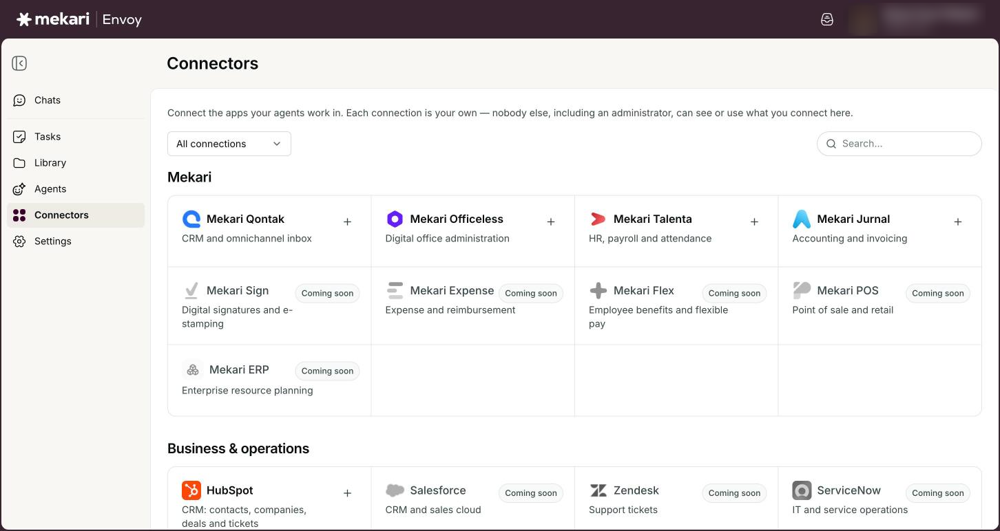
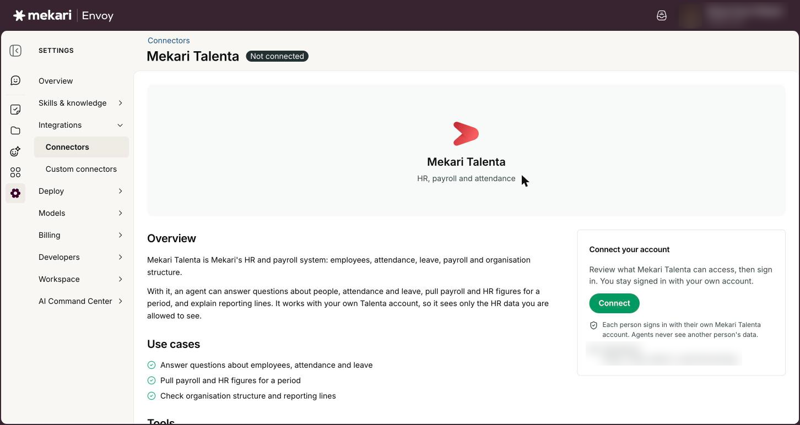
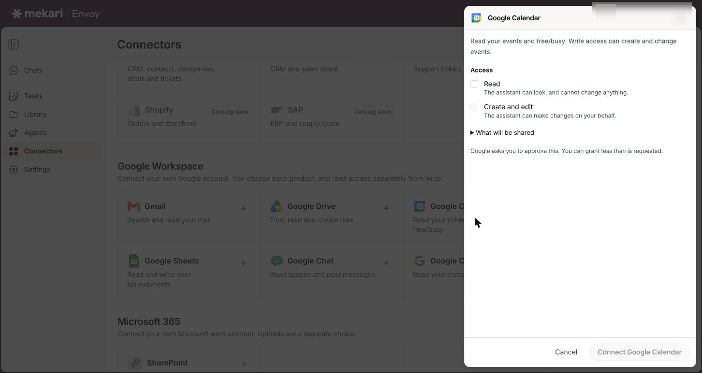
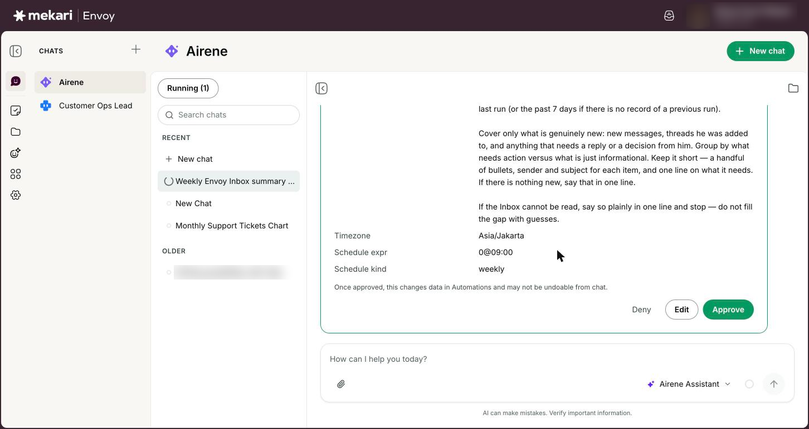

# Connectors (connect your apps)


**General Guide** — for everyone, no technical knowledge needed.


| | |
|---|---|
| **Who this is for** | Everyone who uses Envoy |
| **Where to find it** | **Connectors** in the left rail |
| **Last checked** | 24 October 2026 |

## What it is

Connectors let Airene and your agents work inside the apps you already use. Once you connect an app, an agent can look things up there for you, such as your Gmail, your calendar, a Mekari Talenta report or a Mekari Qontak deal, and, if you allow it, make changes when you ask.

The **Connectors** page is one directory of every app Envoy can reach, grouped into sections such as **Mekari**, **Google Workspace**, **Microsoft 365**, **Productivity** and **Communication**. Apps you can connect today open when you click them. Apps that are planned are greyed out and marked **Coming soon**.

Every connection is your own. You sign in with your own account, agents use it only when you are the one chatting (or in tasks you set up yourself), and nobody else, including an administrator, can see or use what you connect.

## Before you start

* You are signed in to Envoy.
* You have your own account for the app you want to connect (for example your Google work account, or your Mekari Talenta, Jurnal or Qontak login).
* For Google Workspace, an administrator has set it up for your workspace. If not, the section tells you so.

## How to use it

### Find an app in the directory

1. Click **Connectors** in the left rail.
2. Use the filter on the left of the toolbar to choose **All connections**, **Connected**, **Available to connect** or **Coming soon**.
3. Type in **Search…** to find an app by its name or by what it does, for example "spreadsheet" or "payroll".
4. Look at the right corner of each card: a tick means you are connected, a plus means you can connect it, and **Coming soon** means it is not available yet.


Coming soon cards cannot be clicked. They are there so you know an app is planned.


<figure><figcaption>
The Connectors directory: a tick means connected, a plus means you can connect
</figcaption></figure>

### Connect a Mekari app (or another app in the directory)

1. Click the app's card, for example **Mekari Talenta**, **Mekari Jurnal** or **Mekari Qontak**.
2. Read the app's page: the overview, **Use cases** and **Tools** show what an agent can do with it.
3. Under **Connect your account**, click **Connect**.
4. Sign in with your own account in the window that opens, and approve the request.
5. Wait on the Envoy page. It updates by itself, shows "[app name] connected", and takes you back to **Connectors**, where the card now has a tick.


If nothing opens, your browser blocked the window. Click **Open it manually** in the message that appears.


<figure><figcaption>
A connector page (Mekari Talenta) before you connect it.
</figcaption></figure>

### Connect a Google Workspace product and choose read or write

1. In the **Google Workspace** section, click a product: Gmail, Google Drive, Google Calendar, Google Docs, Google Sheets, Google Chat or Google Contacts.
2. In the panel that opens, tick **Read** so the assistant can look but not change anything.
3. If you also want the assistant to act for you, tick **Send and draft** (Gmail) or **Create and edit** (the other products). This box only works once **Read** is ticked.
4. Optional: open **What will be shared** to see exactly what Google will be asked for.
5. Click **Connect** followed by the product name, for example **Connect Gmail**.
6. Approve on Google's screen. You can grant less than is requested. You come back to **Connectors** and see "Google connected."


Connect one product at a time. Each new product is added to the same Google account, so connecting Drive after Gmail keeps both.


<figure><figcaption>
Choosing read or write access for a Google product before you connect
</figcaption></figure>

### Manage a connected Google product

1. Click a connected Google product to open its page.
2. Under **Tools**, open **Read tools** or **Write tools** and use the switches to turn single tools on or off, or click **Enable all** or **Disable all**.
3. To add write access later, click **Actions**, then **Allow send and draft** (Gmail) or **Allow create and edit**.
4. To change your read and write choice, click **Actions**, then **Manage access**.
5. To stop using just this product, click **Disconnect**, then **Disconnect** again in the box that asks you to confirm. The rest of your Google account stays connected.
6. To remove your whole Google account, click **Actions**, then **Manage access**, then **Disconnect Google account**, and confirm with **Disconnect**.


The **Agents** list on the product page shows which agents use this connector.


### Reconnect or disconnect an app

1. Click the connected app's card to open its page.
2. If the sign-in has run out, click **Reconnect** and sign in again.
3. To disconnect, click **Disconnect** on the right of the page, then **Disconnect** again to confirm. Click **Keep it connected** or **Cancel** if you change your mind.
4. For Google, if the **Connectors** page shows **Needs reconnecting** or **Connection problem**, click **Reconnect** right there.


Disconnecting stops agents using your account. It does not delete anything in the app itself.


### Approve access and actions during a chat

1. If an agent needs Google access you have not given yet, a **Google access needed** card appears in the chat. It says what the access is for.
2. Click **Review and allow on Google** and approve. You land on your connectors page afterwards, so go back to the chat and ask again. The tool works from your next message.
3. When an agent wants to change something, such as sending an email, creating an event or updating a record, a card appears that says nothing happens until you confirm.
4. Click **Show details** to check the values, or **Edit** to change them.
5. Click **Confirm** to run it, or **Cancel** to stop it. Some cards say **Needs your approval** and show **Approve** and **Deny** instead.


Typing "yes" in the chat does not run the action. Only the **Confirm** or **Approve** button does. Scheduled tasks never show these cards (see [Tasks](../guides/tasks.md)).


<figure><figcaption>
An action waiting for your approval in a chat, with its details shown.
</figcaption></figure>

## Your options

| Option | What it does |
|---|---|
| **All connections** / **Connected** / **Available to connect** / **Coming soon** | The directory filter. Shows everything, only what you have connected, only what you can still connect, or only planned apps. |
| **Read** | The assistant can look at your data in that app but cannot change anything. |
| **Send and draft** | Gmail only. Lets the assistant draft and send emails for you. In a chat, it always asks you to confirm first. |
| **Create and edit** | Google Drive, Calendar, Docs, Sheets and Chat. Lets the assistant make changes for you. For Google Drive it is limited to files created in Envoy; your existing Drive files stay read-only. |
| Google Contacts | Read only. There is no write choice for contacts. |
| **What will be shared** | A list of exactly what Google will be asked for, shown in the product's panel before you connect. |
| Tool switches | On a connected app's page, each tool has its own switch, grouped into **Read tools** and **Write tools**. Turn off any tool you do not want agents to use. |

## Good to know

* Your connections are private. Agents use your account only when you are the person chatting. If a colleague uses the same agent, it uses their connections, not yours.
* One Google account covers every Google product. **Disconnect** on a product page stops only that product. **Disconnect Google account** removes all of them.
* **Microsoft SharePoint** is listed under **Microsoft 365** but cannot be connected yet. The section, or the message you get when you try, says "Microsoft 365 is not configured for this workspace."
* In a chat, changes such as sending, creating, updating or deleting wait for your **Confirm**. Envoy decides this from the name of each action, so a few actions that only start work in the other app, such as starting an export or generating a document, can run without a card. A confirmed change may not be undoable from chat. Scheduled tasks never show a card, so a task makes the changes its instruction asks for (see [Tasks](../guides/tasks.md)).
* Google connections that have not been used for 90 days are removed automatically. If you connected and never used it, the 90 days count from the day you connected. Envoy also withdraws its access on Google's side. Just connect again when you need it.
* Admins can switch a connector off for the whole company. When they do, you see "Your organization’s admin turned this connector off. Ask them to turn it back on in Connector access." and you cannot connect it. Admins can also choose who in the company may connect a given app. See [Company AI controls & Connector access](../for-admins/company-ai-controls-and-connector-access.md).
* Disconnecting in Envoy does not remove anything from the app. To remove Envoy on Google's side too, use the **Google account permissions** link shown when you disconnect.
* Your company may allow only certain Google email domains. A personal Google account may be refused.
* The directory also lists **Morning Brief** (see [Morning Brief & Meeting assistant](../guides/morning-brief-and-meeting-assistant.md)) and the **Slack bot** and **Google Chat bot** (see [Envoy in Slack & Google Chat](../guides/envoy-in-slack-and-google-chat.md)). Calendar's meeting assistant is covered in [Morning Brief & Meeting assistant](../guides/morning-brief-and-meeting-assistant.md).
* Need an app that is not listed? Ask your company admin.

## Ideas to try

* Connect Gmail with **Read**, then ask: "Summarise the emails from my manager this week."
* Connect Google Calendar with **Create and edit**, then ask: "Find a free hour on Thursday and set up a meeting with Rina." Check the card, then click **Confirm**.
* Connect Mekari Talenta, then ask: "How many people in my team are on leave next week?"
* Connect Google Drive with **Read**, then ask: "Find the latest version of our pricing deck and summarise what changed."

## If something goes wrong

| What you see | What to do |
|---|---|
| "Google is not configured for this workspace. Ask an administrator to set it up." | Google Workspace has not been set up for your company yet. Ask your Envoy administrator. (The same message for **Microsoft 365** means it is not available yet; see Good to know.) |
| "That connector is not available on this deployment." | The Envoy team has not finished setting this app up, so nobody can connect it yet. Ask your admin or the Envoy team when it will be ready. |
| "That Google account is outside the allowed domain." | Connect with your Mekari work Google account instead of a personal one. |
| "You cancelled the Google consent screen." or "That sign-in link expired or was already used." | Open the product again and click **Connect** to start a fresh sign-in. |
| "Google did not return a durable connection. Remove this app's access in your Google account, then reconnect." | Open your Google account permissions, remove Envoy's access, then connect the product again in Envoy. |
| "Your browser blocked the sign-in window." | Click **Open it manually** in the same message, or allow pop-ups for Envoy and click **Connect** again. |
| "The sign-in timed out. Try connecting again." | The page waits about 5 minutes for you to finish signing in. Click **Connect** again and finish sign-in in the new window. |
| In a chat: "[app name] needs to be reconnected. Its tools are unavailable in this reply." | Click **Reconnect** in the message, sign in again on the app's page, then ask your question again. |
| A Write tool is greyed out and the page says you connected the product with read access only | Click **Actions**, then **Allow send and draft** or **Allow create and edit**, and approve on Google's screen. |
| Signing in to a Mekari app fails when you are away from the office | Mekari app sign-ins go through Mekari's own network. Connect to the Mekari VPN and try again. |
| Mekari Officeless keeps asking you to reconnect | On its page, use **Connect with client ID** with the client ID and secret from your Officeless admin. That connection renews itself, so you do not need to sign in again. |

## Related guides

* [Chatting with Airene](../guides/chatting-with-airene.md)
* [Agents](../guides/agents.md)
* [Morning Brief & Meeting assistant](../guides/morning-brief-and-meeting-assistant.md)
* [Your AI data & memory](../guides/your-ai-data-and-memory.md)
* [Envoy in Slack & Google Chat](../guides/envoy-in-slack-and-google-chat.md)
* [Company AI controls & Connector access](../for-admins/company-ai-controls-and-connector-access.md)
