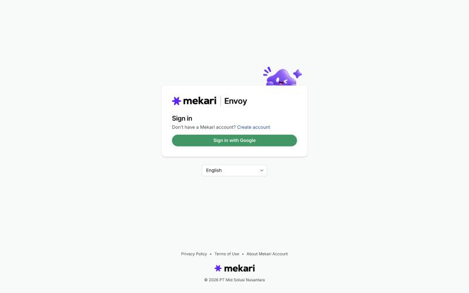
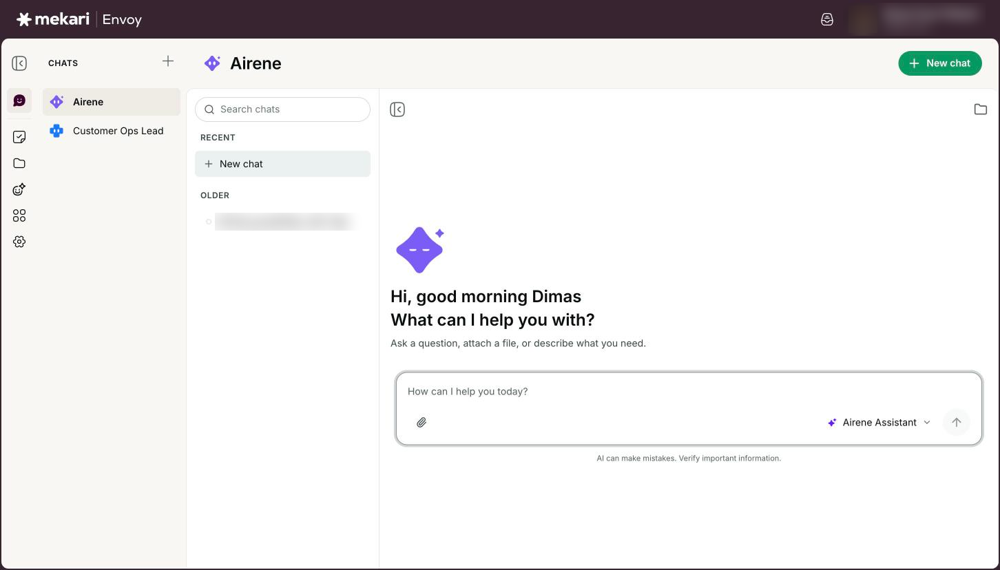
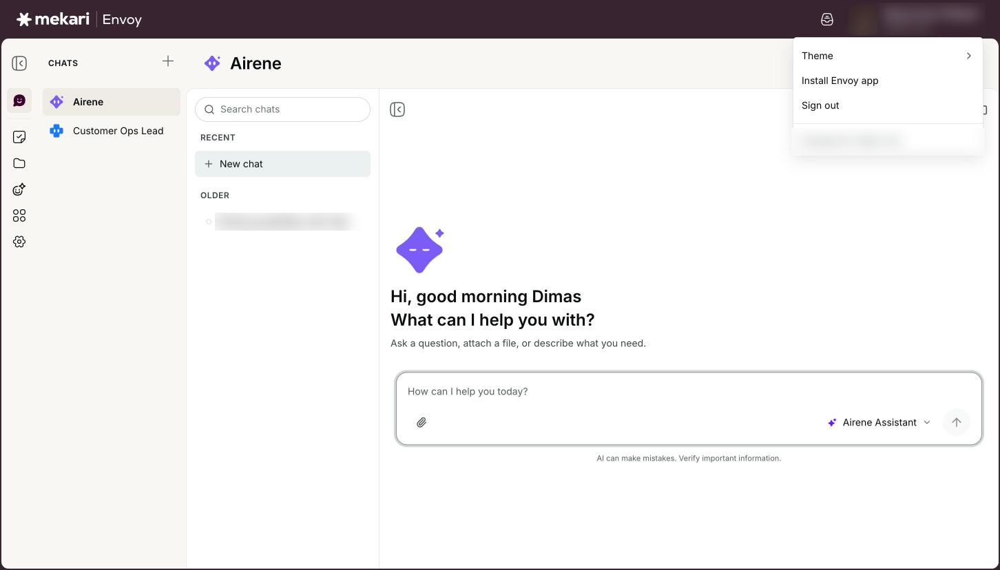
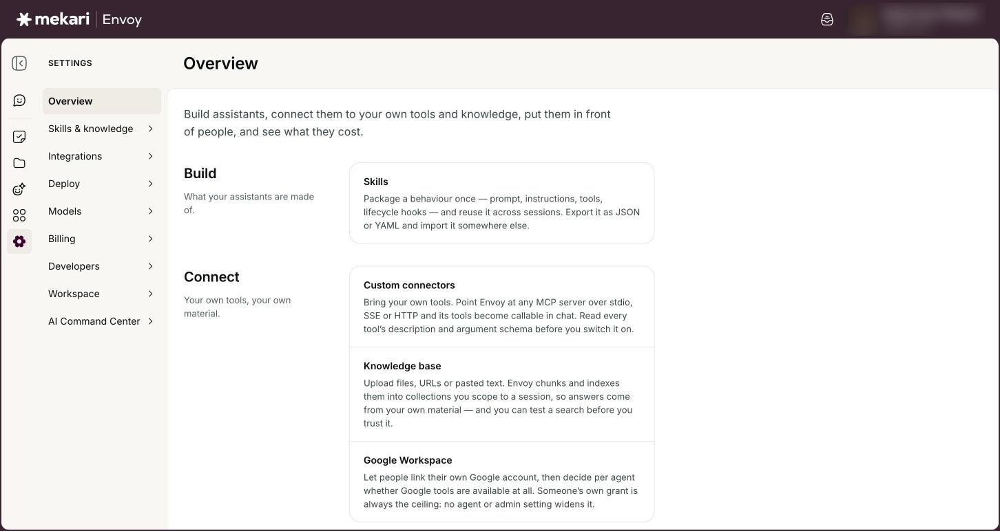

# Getting started


**General Guide** — for everyone, no technical knowledge needed.


| | |
|---|---|
| **Who this is for** | Everyone who uses Envoy |
| **Where to find it** | Open Mekari Envoy in your browser and click **Sign in with Google** |
| **Last checked** | 24 October 2026 |

## What it is

Mekari Envoy is Mekari's AI workspace. You chat with Airene, Envoy's built-in assistant, or with agents your team has set up. Envoy can make files for you, run tasks on a schedule, and work with the apps you connect.

This guide shows you how to sign in, what each part of the screen is for, what your role lets you do, and where to find your settings.

## Before you start

* Your Mekari work Google account.
* An invitation. You can only sign in after an admin of your company has added you on the **Users** page (see [Managing people](../for-admins/managing-people.md)). Your first sign-in after that sets up your account.
* A recent version of Chrome, Edge, Safari or Firefox.

## How to use it

### Sign in

1. Open Mekari Envoy. The sign-in screen says **Hi, I’m Airene.** and **Sign in and let’s get to work.**
2. Click **Sign in with Google**.
3. Choose your Mekari work Google account on the Google page that opens.
4. Wait to be brought back to Envoy. You land on the page you were trying to open, or on Chats.


The button always names the account to use. The **Create account** link under **Don’t have a Mekari account?** opens the same sign-in; it does not give you access by itself.


<figure><figcaption>
The Envoy sign-in screen
</figcaption></figure>

### Find your way around the screen

1. Use the left rail to move between the main areas: **Chats**, **Tasks**, **Library**, **Agents**, **Connectors** and **Settings**.
2. Click **Chats** to talk to Airene or one of your agents. Your past chats are listed beside the conversation, grouped into **Recent**, **This week** and **Older**.
3. Click the bell at the top right to see **Notifications** from your tasks and monitors. Click **Mark all read** to clear them, or **View all** to open your inbox.
4. Click your name at the top right to open your account menu.
5. Click the Mekari Envoy logo at any time to go back to a new chat.


The toggle at the top of the rail collapses or expands it; on a chat page it hides or shows your chat list instead. On a phone, the menu button opens the navigation as a drawer.


<figure><figcaption>
The main Envoy screen
</figcaption></figure>

### Use the account menu

1. Click your name and company at the top right.
2. Click **Switch company**, then pick a company from the **Company list**, if you belong to more than one. The check mark shows the company you are working in.
3. Click **Theme**, then choose **System**, **Light** or **Dark**.
4. Click **Install Envoy app** to add Envoy to your computer as an app. This row only appears when your browser offers it.
5. Click **Sign out** when you are done. This signs you out of Envoy only, not out of your Google account.


Your **Company ID** is shown at the bottom of the menu. Support may ask you for it.


<figure><figcaption>
The account menu
</figcaption></figure>

### Open Settings

1. Click **Settings** in the left rail, or press Ctrl+, (Cmd+, on a Mac).
2. Read the overview page. It groups what you can open into **Build**, **Connect**, **Deploy** (putting an assistant where people already work), **Trust** and **Administer**.
3. Click a card to open that page, or pick a page from the Settings menu on the left.


You only see cards and menu items for pages your role lets you open, so your Settings may look shorter than a colleague's.


<figure><figcaption>
The Settings overview
</figcaption></figure>

## Your options

| Option | What it does |
|---|---|
| **Admin** | Full access. Manages the organization, its users, and every setting. Admins see extra Settings pages such as **Users**, **Groups**, **Company AI controls** and **Connector access**. |
| **Member** | Works day-to-day: uses the assistant, agents, skills, and documents. Members can create their own agents, skills and tasks, and change the ones they own. |
| **Viewer** | Read-only access. Cannot make changes or view credentials. A viewer can read chats but sees **Read-only access. You can read this conversation but not reply.** instead of a message box. |
| **Theme** | **System** follows your computer's light or dark setting. **Light** and **Dark** fix the look for this browser. |

## Good to know

* Each sign-in lasts up to 12 hours. After that Envoy shows the sign-in screen again; sign in and you return to the page you were on.
* **Sign out** ends your Envoy session only. On a shared computer, also sign out of your Google account in that browser.
* Everything you do happens inside the company shown under your name. Switching company changes which chats, agents and files you see.
* Your role is set per company. You can be an admin in one company and a member in another.
* Everyone can open these Settings pages for themselves: **AI data & memory**, **Notifications** and **Connected platforms**.
* Removing someone from a company signs them out of it straight away and disconnects the apps they connected there. Their scheduled tasks are deleted unless the admin hands their work to another member (see [Managing people](../for-admins/managing-people.md)). Their chats stay.
* Only English is offered in the language picker on the sign-in screen for now.
* If Envoy is slow to start you may see **Still connecting to Mekari Envoy — hang tight.** This usually clears by itself.
* **Install Envoy app** puts Envoy on your computer as its own window. There is no Envoy phone app yet.

## Ideas to try

* Ask Airene: "What can you help me with in Envoy?"
* Open **Settings** and read the overview to see what your role lets you set up.
* Install Envoy as an app from your account menu so it opens in its own window.

## If something goes wrong

| What you see | What to do |
|---|---|
| "Access Not Granted" with "This account does not have access to AI Gateway. Ask an administrator to add you, then sign in again." | Nobody has added you to Envoy yet, or you used a different Google account. Ask your company admin to add your work email on the **Users** page, then sign in again with that account. |
| "Can't reach Mekari Envoy right now." | Check your internet connection, then click **Try again**. If it keeps happening, tell your IT or Envoy admin. |
| "Could not switch company." | You may no longer be a member of that company. Ask an admin of that company to add you again. |
| You do not see **Switch company** in the account menu. | It only appears when you belong to two or more companies. |
| A Settings page a colleague mentioned is missing for you. | Some pages are for admins only. Ask your company admin to check your role on the **Users** page. |

## Related guides

* [Chatting with Airene](../guides/chatting-with-airene.md)
* [Agents](../guides/agents.md)
* [Your AI data & memory](../guides/your-ai-data-and-memory.md)
* [Managing people](../for-admins/managing-people.md)
