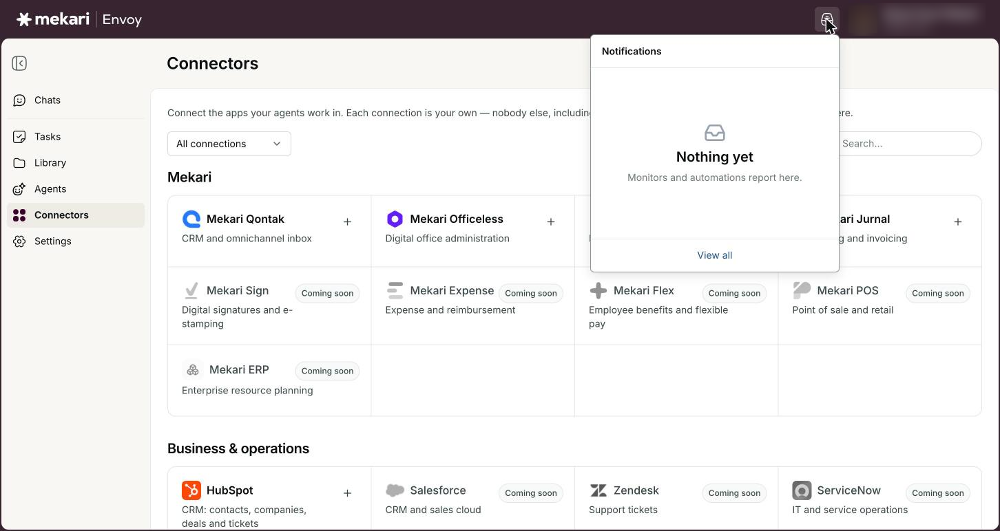
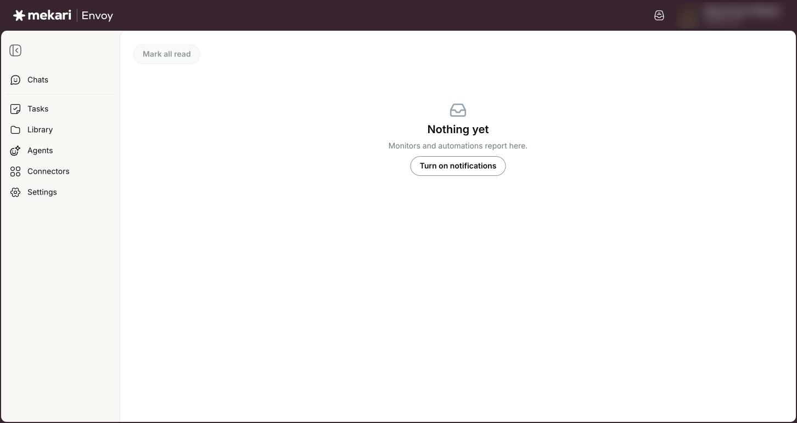
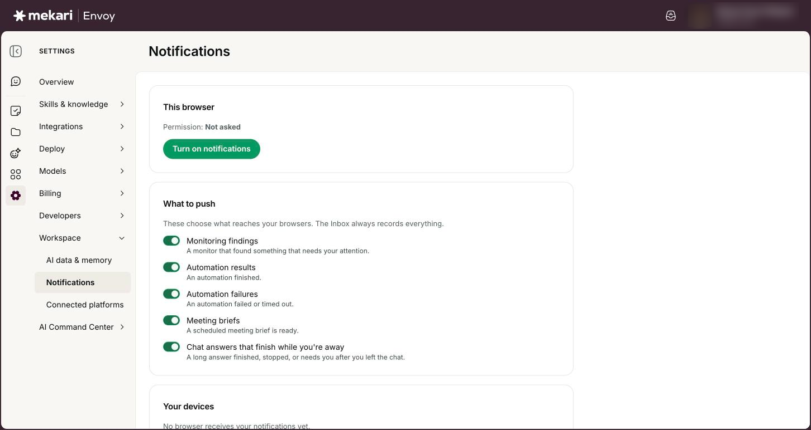

# Inbox & notifications


**General Guide** — for everyone, no technical knowledge needed.


| | |
|---|---|
| **Who this is for** | Everyone who uses Envoy |
| **Where to find it** | The **Notifications** icon at the top right, next to your name (then **View all** for the full Inbox) |
| **Last checked** | 24 October 2026 |

## What it is

Your Inbox is where Envoy reports back to you when you are not watching. Monitors, automations (tasks), meeting briefs, your Morning Brief and long chat answers that finish after you leave all leave a note here.

The **Notifications** icon at the top of every page shows how many notes you have not read yet. Click it to see the newest ones, or open the full Inbox page to see everything.

Browser pop-up notifications are not switched on yet. Until they are, the bell and the Inbox are where every note arrives, so check them when you come back to Envoy.

## Before you start

* Nothing to set up: your Inbox fills on its own as your tasks, monitors and briefs run.
* Keep an Envoy tab open, or install Envoy as an app, if you want to see the unread number change while you work.

## How to use it

### Check your newest notifications

1. Look at the **Notifications** icon at the top right. A number on it means you have unread notes (it shows **9+** when there are more than nine).
2. Click the icon to open the **Notifications** list. It shows your 8 newest notes, each with a type label such as **Automation** or **Meeting brief** and how long ago it arrived.
3. Click a note to open it. It is marked as read and takes you to where it points, for example the chat with the task's result or the Library page of your Morning Brief.
4. Click **Mark all read** to clear the unread dots in one go.
5. Click **View all** to open the full Inbox page.


The unread number refreshes about once a minute while the Envoy tab is open.


<figure><figcaption>
The Notifications menu under the bell (empty in this example).
</figcaption></figure>

### Use the Inbox page

1. Click the **Notifications** icon, then **View all**.
2. Scan the table: a dot marks an unread note, **Type** shows what sent it, **Notification** shows the title and a preview, and **Received** shows when it arrived.
3. Click a row to open it. Notes from monitors open in place so you can read the full text; others take you to the chat or page they belong to.
4. In an opened monitor or automation note, click **View run history** to see that task's past runs.
5. Click **Load more** at the bottom to see older notes (the page loads 25 at a time).
6. Click **Mark all read** at the top to mark everything as read.

<figure><figcaption>
The Inbox page (empty in this example).
</figcaption></figure>

### Install Envoy as an app

1. Open **Settings** → **Notifications** and find **Install app**, or open the menu under your name and choose **Install Envoy app**.
2. Click **Install** and confirm in your browser.
3. Envoy now opens in its own window, with its icon in your dock or taskbar.


These options only appear when your browser offers to install Envoy. Once installed, right-click the Envoy icon in your dock or taskbar to jump straight to **New chat** or **Inbox**.


<figure><figcaption>
Settings → Notifications: This browser and What to push.
</figcaption></figure>

## Your options

| Option | What it does |
|---|---|
| **Monitor** | A watching task found something that needs your attention. Opens in place so you can read the full note. |
| **Automation** | One of your tasks finished and has a result for you. |
| **Automation failed** | One of your tasks failed or ran out of time. A failed task always leaves a note. |
| **Meeting brief** | A scheduled meeting brief or your Morning Brief is ready. |
| **Chat answer** / **Chat failed** / **Needs you** | A long chat answer finished, could not finish, or is waiting for your decision after you left the chat. |

## Good to know

* Your Inbox is personal. You only see notes about your own tasks, monitors, briefs and chats.
* Notes are kept for 90 days, then removed automatically.
* A task that ran and found nothing new does not create a note. A failed task always does.
* Meeting brief notes come only from scheduled briefs, not from ones you start yourself with a button.
* A chat answer only creates a note if you left the chat for more than about 30 seconds before it finished.
* **Settings** → **Notifications** currently says "Push notifications are not available here. The Inbox still collects everything." This is expected: browser pop-ups are not switched on for Envoy yet. The switches under **What to push** have no effect until they are.

## Ideas to try

* Check your Inbox first thing each morning to catch monitor findings that arrived overnight.
* Ask Airene a long research question, switch to other work, and come back when the bell shows a **Chat answer** note.
* Open an **Automation failed** note and click **View run history** to see what went wrong.
* Install Envoy as an app so it has its own window and you can jump to **Inbox** from its icon.

## If something goes wrong

| What you see | What to do |
|---|---|
| "Push notifications are not available here. The Inbox still collects everything." | Browser pop-ups are not switched on for Envoy yet. Nothing is lost: keep using the bell and the Inbox. |
| "Your inbox did not load" or "Could not load your notifications." | Click **Try again**. If it keeps happening, reload the page. |
| The Inbox says "Nothing yet". | Nothing has reported to you yet. Notes appear once one of your tasks, monitors or briefs runs. |
| The unread number does not change while you work | It refreshes about once a minute while the Envoy tab is open. Click the **Notifications** icon to load the newest notes straight away. |
| You do not see **Install Envoy app** in the menu under your name | Your browser has not offered to install Envoy, or it is already installed. Try a browser that supports installing web apps, such as Chrome. |

## Related guides

* [Tasks](../guides/tasks.md)
* [Morning Brief & Meeting assistant](../guides/morning-brief-and-meeting-assistant.md)
* [Chatting with Airene](../guides/chatting-with-airene.md)
* [Getting started](../guides/getting-started.md)
