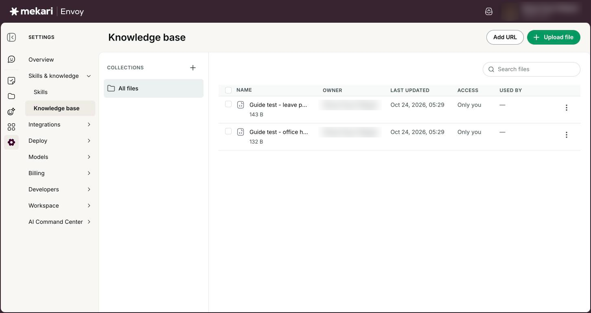
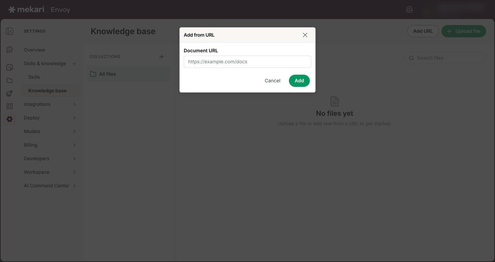
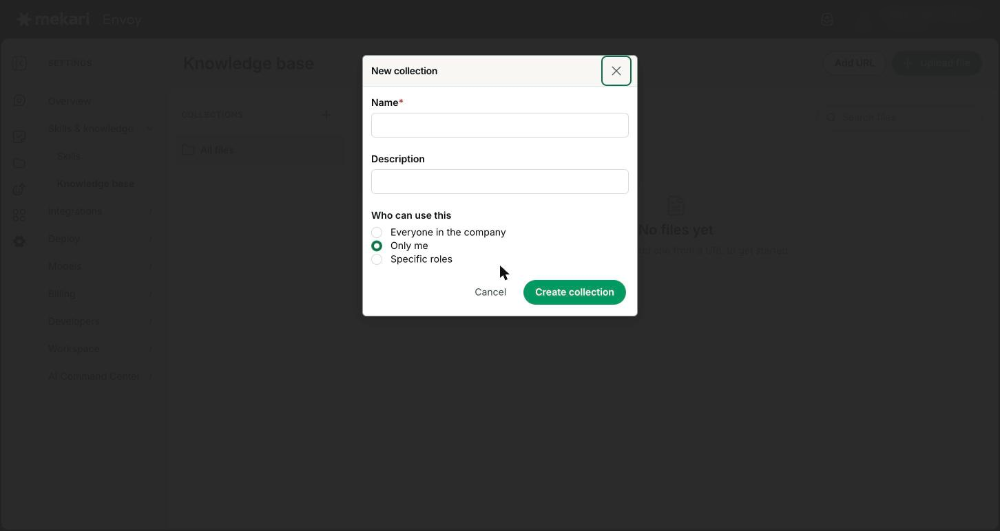
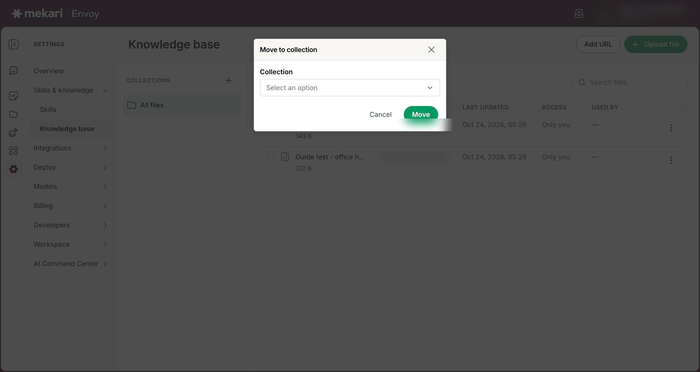
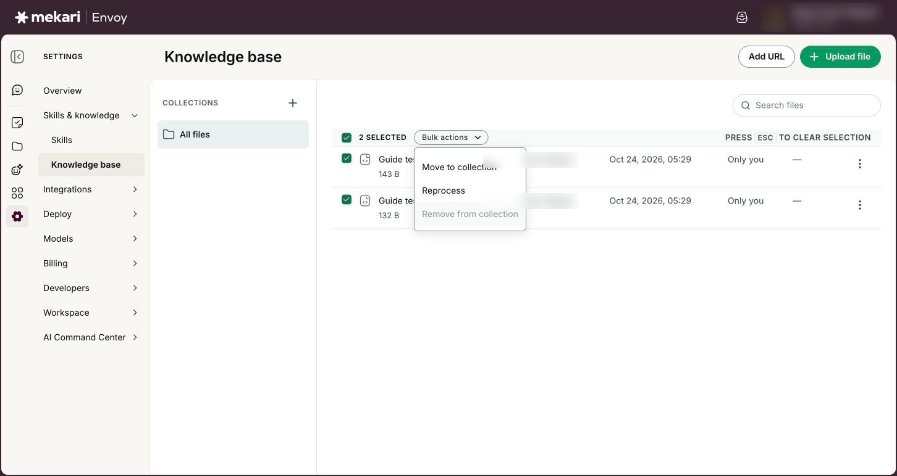
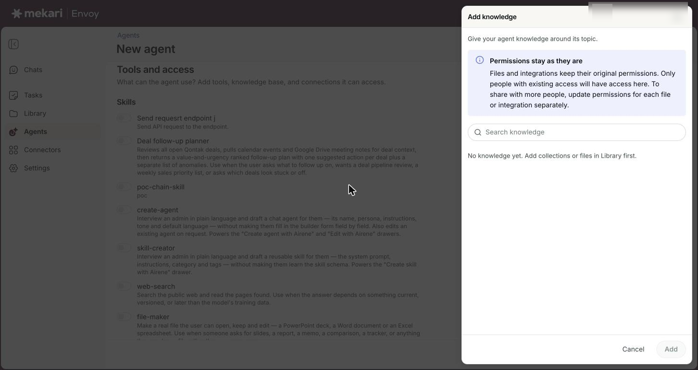

# Knowledge base


**General Guide** — for everyone, no technical knowledge needed.


| | |
|---|---|
| **Who this is for** | Everyone who uses Envoy. Adding and changing files needs the Admin or Member role. |
| **Where to find it** | **Settings** in the left rail, then **Knowledge base** under **Skills & knowledge** |
| **Last checked** | 24 October 2026 |

## What it is

The knowledge base is where you keep your team's own material, such as policies, product sheets, price lists and help pages, so agents can answer from it instead of from general knowledge.

You add files from your computer or add a web page by its address. Envoy reads each one and gets it ready for agents to look things up in. You can sort your files into **Collections**, which work like folders.

Agents use the knowledge base through the collections attached to them. When you set up an agent, you choose which collections it may read, and from then on it can quote those files when people chat with it.

## Before you start

* You are signed in to Envoy and can see **Settings** in the left rail.
* To add, move or delete files you need the Admin or Member role. With the Viewer role you can browse the list but not change it.
* Your files are PDF, TXT, DOCX or CSV, and each one is 50 MB or smaller. Web pages must be public pages that open without signing in.

## How to use it

### Upload files

1. Click **Settings** in the left rail, then **Knowledge base**.
2. Optional: click a collection on the left first. Files you upload while a collection is open go straight into it.
3. Click **Upload file** at the top of the page.
4. Choose one or more PDF, TXT, DOCX or CSV files and confirm.
5. Wait for the **File uploaded** message. The file now shows in the list with its size under its name.


You can also drag files from your computer onto the file list. When you see **Drop files to upload**, let go.


<figure><figcaption>
The Knowledge base page with two uploaded files.
</figcaption></figure>

### Add a web page

1. On the **Knowledge base** page, click **Add URL**.
2. In the **Add from URL** window, paste the full address into **Document URL**, starting with https://.
3. Click **Add**.
4. Wait for the **Document added** message. The page shows in the list with the website name under it.


Envoy reads that one page only. It does not follow the links on it, so add each page you need.


<figure><figcaption>
Adding a public web page by its address
</figcaption></figure>

### Create and manage collections

1. In the **Collections** list on the left, click the plus button next to the heading (its tip reads **New collection**).
2. Type a **Name**. A **Description** is optional.
3. Under **Who can use this**, choose **Everyone in the company**, **Only me** or **Specific roles** (then tick **Admins**, **Members** or **Viewers**). Admins can also choose **Specific groups**.
4. Click **Create collection**. The choice shows in small text under the collection's name.
5. To change a collection's name, description or who can use it, click the **⋮** button next to it, choose **Edit**, then click **Save changes**. To remove it, choose **Delete**.
6. Click **All files** at the top of the list to see every file again.


Deleting a collection does not delete its files. They stay in the knowledge base, just no longer in that collection.


<figure><figcaption>
Creating a collection and choosing who can use it
</figcaption></figure>

### Move files into a collection

1. For one file, click the **⋮** button at the end of its row and choose **Move to collection**.
2. Pick the collection under **Collection** and click **Move**.
3. For several files, tick the box next to each file name (or the box in the header to select all).
4. Click **Bulk actions**, choose **Move to collection**, pick the collection and click **Move**.


A file sits in one collection at a time. Moving it to another collection takes it out of the first one. You can only move files into a collection you created, unless you are an admin.


<figure><figcaption>
The Move to collection window.
</figcaption></figure>

### Use bulk actions

1. Tick the files you want to work on. The header shows how many are selected.
2. Click **Bulk actions**.
3. Choose **Reprocess** to have Envoy read the selected files again, for example after a web page you added has changed.
4. Or choose **Remove from collection**, then click **Remove**. The files stay in the knowledge base. Only their collection link is removed.
5. Press **Esc** to clear your selection.


**Remove from collection** is greyed out when none of the selected files are in a collection.


<figure><figcaption>
Two files ticked and the Bulk actions menu open.
</figcaption></figure>

### Fix or delete a file

1. If a file shows **Needs attention**, read the message under its name to see what went wrong.
2. Fix the cause if you can, for example make the web page public again.
3. Click the file's **⋮** button and choose **Reprocess**.
4. To delete a file, click its **⋮** button, choose **Delete**, then click **Delete** in the **Delete document?** window.


Deleting a file cannot be undone. Agents stop using it straight away.


<figure><figcaption>
The options menu on a file: Move to collection and Delete.
</figcaption></figure>

### Give an agent your knowledge base

1. Click **Agents** in the left rail and open the agent you look after.
2. Click **Actions**, then **Edit**.
3. Under **Tools and access**, find **Knowledge base** and click **Add collection or file**.
4. In the **Add knowledge** panel, tick the collection you want. A ticked collection includes all its files, including files you add to it later.
5. Click **Add**, then click **Save changes**.


Attach collections, not single files. A file attached to an agent on its own is not read, so put it in a collection and attach the collection. The panel only lists collections you are allowed to use.


<figure><figcaption>
Attaching collections to an agent
</figcaption></figure>

## Your options

| Option | What it does |
|---|---|
| **Owner** | Who added the file. **Former user** means the person who added it no longer has an account. |
| **Last updated** | The date and time the file was added, in your time zone. |
| **Access** | **Only you** means you added the file. A person's name means that colleague added it. **Everyone** means it was added by a connected system rather than a person, and every member of your company can see it. |
| **Who can use this** | Set on each collection. **Everyone in the company**, **Only me**, **Specific roles** or (admins only) **Specific groups**. New collections start as **Everyone in the company** when an admin makes them and **Only me** when a member does. Older collections may say "Not set: visible as before this setting existed." People only see and pick collections they are allowed to use. Admins see them all. |
| **Used by** | How many agents in your company use the collection this file is in. A dash means no agent uses it, or the file is not in a collection. |
| **Uploading** and **Processing** | Envoy is still reading the file. The list refreshes by itself every 2 seconds until it is done. |
| **Needs attention** | Envoy could not read the file. The reason is shown under the file name. Fix it, then use **Reprocess**. |
| **Search files** | Finds files whose name contains what you type. Press Enter to search. |
| Column sorting | **Name**, **Owner**, **Last updated** and **Used by** each have a sort menu next to the heading. |

## Good to know

* Supported files are PDF, TXT, DOCX and CSV, up to 50 MB each. Older Word files (.doc) and Excel files are not supported, so save them as DOCX or CSV first.
* Save TXT and CSV files with UTF-8 text encoding. Most apps offer this in their save or export options.
* For web pages, Envoy reads one public page at a time. Pages behind a sign-in, and internal company addresses, cannot be read. A link that ends in a PDF file is read as a PDF.
* Members see the files they added themselves plus files marked **Everyone**. Admins and viewers see every file in the company by default. Viewers cannot add, move or delete anything.
* You can delete files you added. Admins can delete any file. Deleting a file cannot be undone, but removing it from a collection or deleting the collection keeps the file.
* Only the person who created a collection, or an admin, can edit it, delete it, or add and remove its files.
* The **Use all company-wide files** switch under **Knowledge base** in an agent's setup is not saved with the agent yet, so it does not change what the agent reads. Attach collections with **Add collection or file** instead.
* The list shows 15 files at a time. Click **Load more** at the bottom to see the rest.
* Collection names must be unique within your company. Your company can have up to 100 collections, and each collection can hold up to 100 files.

## Ideas to try

* Make a collection called "HR policies", upload your leave and claims policies as PDF, and attach it to your team's HR helper agent.
* Add your product's public help pages with **Add URL**, then use **Bulk actions** and **Reprocess** after the pages are updated.
* Upload a price list as CSV so an agent can answer "How much is the Pro plan for 50 users?"
* Keep one collection per team or topic, so each agent only reads what it needs.

## If something goes wrong

| What you see | What to do |
|---|---|
| "Unsupported file type. Allowed: PDF, TXT, DOCX, CSV." | Save the file in one of those formats, for example save a .doc as .docx or export a spreadsheet as CSV, then upload it again. If you uploaded several files, the others still went in. |
| "File exceeds maximum size of 50MB." | Split the file into smaller parts, or remove large images from it, and upload again. |
| "Only http/https URLs are allowed." | Paste the full web address, starting with https:// or http://. |
| A file shows **Needs attention** | Read the message under the file name, fix the cause, then click the file's **⋮** button and choose **Reprocess**. |
| An upload failed and the file is not in the list | When Envoy cannot read a new file it does not keep it. Check the error message, fix the file, and upload it again. |
| I cannot see **Upload file** or **Add URL** | You have the Viewer role, which can only browse. Ask a company admin if you need to add files. |
| "Collection name '…' already exists." | Choose a different name. Each collection name can be used once in your company. |
| "Maximum of 100 documents per collection." or "Maximum of 100 collections." | Make a second collection for the extra files and attach both to the agent, or delete a collection you no longer need. |
| "No files in this collection." but I know it has files | Click **Load more** at the bottom of the list. The page loads 15 files at a time and the collection view only shows the files loaded so far. |
| My agent does not seem to use my files | Check that the files have no status badge (so they are ready), that they are in a collection, that the collection itself (not single files) is attached under the agent's **Knowledge base**, and that you clicked **Save changes**. |
| I cannot see a file a colleague added | Members only see their own files and files marked **Everyone**. Ask a company admin, who can see every file. |

## Related guides

* [Agents](../guides/agents.md)
* [Getting started](../guides/getting-started.md)
* [Library](../guides/library.md)
* [Skills](../guides/skills.md)
* [Managing people](../for-admins/managing-people.md)
