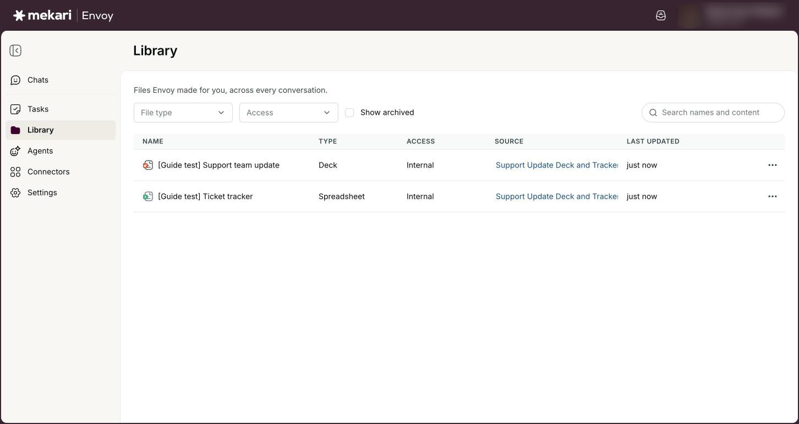
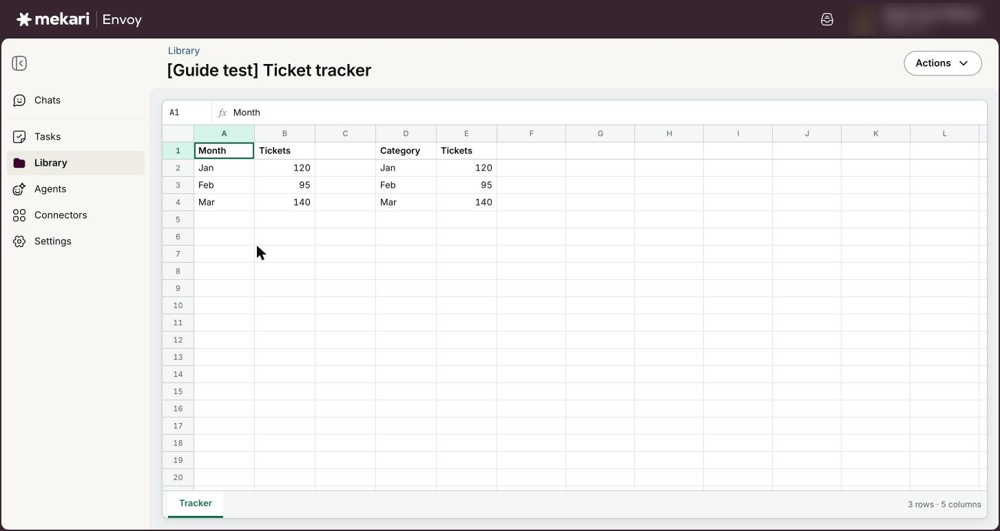
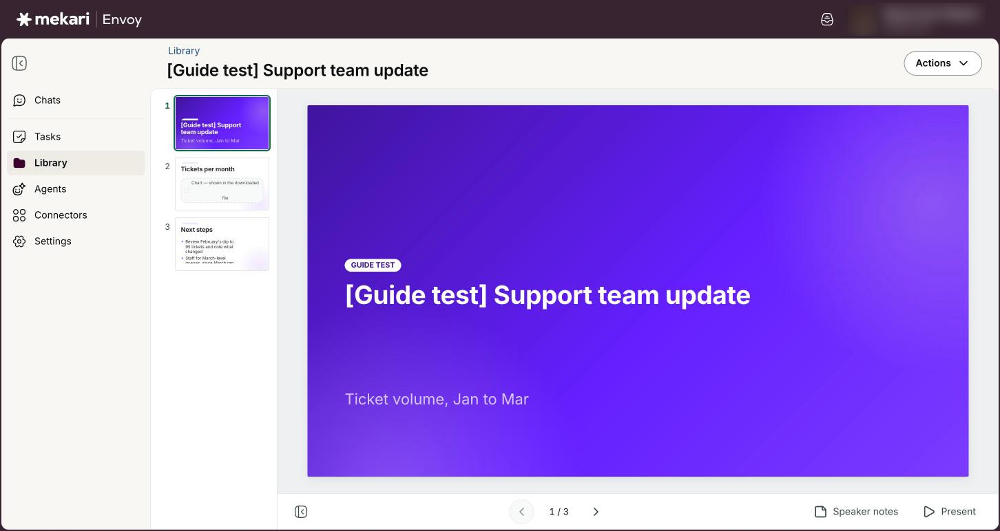
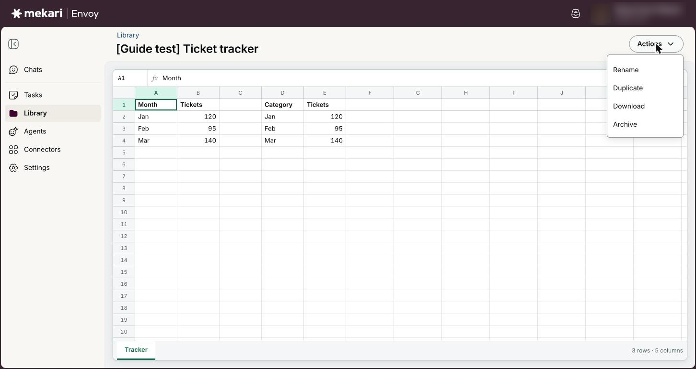
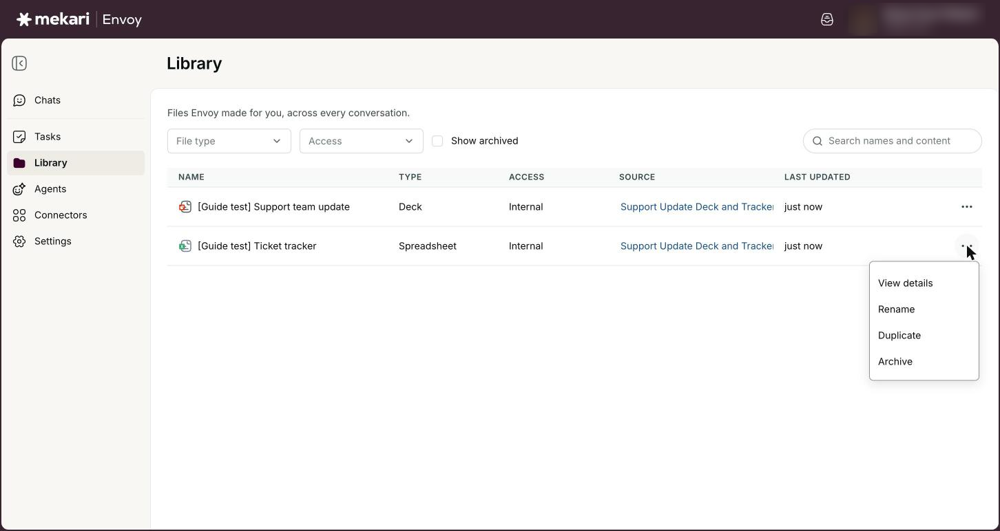
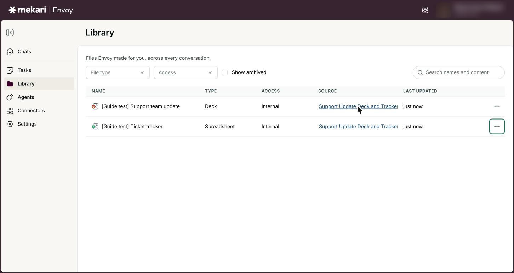

# Library


**General Guide** — for everyone, no technical knowledge needed.


| | |
|---|---|
| **Who this is for** | Everyone who uses Envoy |
| **Where to find it** | **Library** in the left rail |
| **Last checked** | 24 October 2026 |

## What it is

Your Library holds the files Envoy made for you, across every conversation. When you ask Airene or an agent for a deck, a document, a spreadsheet or a markdown file, it appears as a card in the chat and is kept here.

From the Library you can find a file again, preview it, present a deck, download it, rename or duplicate it, and archive what you no longer need. Each file links back to the chat it came from.

## Before you start

* Ask for a file in any chat first, for example "Make a short deck about our Q3 results". Until you do, the Library shows **Artifacts are files Envoy makes for you** and a **Start a conversation** button.

## How to use it

### Find a file

1. Click **Library** in the left rail.
2. Type in **Search names and content** and press Enter. Envoy looks in file names and inside the files.
3. Use **File type** to show only one kind: **Deck**, **Document**, **Spreadsheet**, **Markdown** or **Page**.
4. Use **Access** to show only files with a given label: **Public**, **Internal**, **Confidential** or **Restricted**.
5. Tick **Show archived** to include files you have archived.
6. Click a column heading such as **Name** to sort the list.


Click **Clear filters** to go back to the full list.


<figure><figcaption>
The Library with two files Envoy made in a chat.
</figcaption></figure>

### Open and preview a file

1. Click a file's name in the list.
2. Read the preview. Decks show slide by slide, documents show their text and structure, and spreadsheets show their values in a grid with one tab per sheet.
3. Click **Library** in the breadcrumb at the top to go back.


In a chat, click **View** on a file card to preview it beside the conversation without leaving the chat.


<figure><figcaption>
Previewing a file
</figcaption></figure>

### Present a deck

1. Open a deck from the Library.
2. Click **Present** to show it full screen.
3. Use the arrow keys to move between slides.
4. Press g to show or hide the slide grid, and n to show or hide the speaker notes.
5. Press Esc to leave full screen.

<figure><figcaption>
A deck in the viewer
</figcaption></figure>

### Download a file

1. Open the file.
2. Click **Actions**, then **Download**.
3. Open the downloaded file in PowerPoint, Word, Excel or another app that reads it.


You can also click **Download** on a file card in the chat, or ask Airene to send it, for example "Email this deck to me": with Gmail connected with **Send and draft**, it attaches the file to an email or a draft after you confirm the card. Envoy cannot make PDF files yet; download a document and save it as PDF from Word or another app.


<figure><figcaption>
The Actions menu on a file
</figcaption></figure>

### Rename, duplicate, archive or restore

1. In the Library list, click the actions button on a file's row (or open the file and click **Actions**).
2. Click **Rename**, type the new name and click **Save**.
3. Click **Duplicate** to make a copy you can change separately.
4. Click **Archive** and confirm to take a file out of your Library list.
5. To bring a file back, tick **Show archived**, open the file's actions and click **Restore**.

<figure><figcaption>
Row actions in the Library
</figcaption></figure>

### Go back to the chat a file came from

1. Find the file in the Library list.
2. Look in the **Source** column. It names the conversation that made the file.
3. Click the conversation name to open that chat.


To change a deck, ask in that chat, for example "Add a slide with next steps". The card shows the new version number, such as v2. Only the newest version can be opened or downloaded, so duplicate the file first if you want to keep the original.


<figure><figcaption>
The Source column links each file back to the chat that made it.
</figcaption></figure>

## Your options

| Option | What it does |
|---|---|
| **Deck** | A PowerPoint presentation. The viewer has slide arrows, a slide grid, speaker notes and **Present**. |
| **Document** | A Word document. The preview shows text and structure; fonts, spacing and images are in the downloaded file. |
| **Spreadsheet** | An Excel workbook. The preview shows values; formats and charts are in the downloaded file. Envoy writes values, not formulas: anything starting with = is kept as plain text, so add your own formulas after you download it. |
| **Markdown** and **Page** | A plain formatted text file, or a web page Envoy built for you. Both open in the viewer and can be downloaded. |
| **Access** | The sensitivity label on a file: **Public**, **Internal**, **Confidential** or **Restricted**. New files are labelled **Internal**. |

## Good to know

* Your Library is private to you. Only you see the files Envoy made in your chats; colleagues cannot open them from their Library.
* There is no delete. Archiving hides a file from your Library list and you can restore it any time.
* Previews are approximate. If something looks off, download the file: the download is the real file and is never affected by a preview problem.
* Very long documents and big sheets are cut short in the preview, and the viewer says so. Download the file to see everything.
* Size limits: a deck can have up to 20 slides, with charts on up to 10 of them. A spreadsheet can have up to 8 sheets, each with up to 20 columns and 500 rows, and up to 3 charts per sheet. For something bigger, ask for it in parts.
* Airene can make changes to a deck it already made when you ask in the same chat.
* Files belong to the company you were working in when they were made. Switch company to see that company's files.

## Ideas to try

* Ask Airene: "Turn this chat into a one-page summary document." Then find it in your Library and download it.
* Ask: "Make a spreadsheet tracker of these ten action items with owner and due date columns."
* Open a deck from the Library and click **Present** to rehearse before a meeting.
* Duplicate a deck before asking Airene to rework it, so you keep the original.

## If something goes wrong

| What you see | What to do |
|---|---|
| "Couldn't load artifacts." | Click **Retry**. If it keeps happening, check your connection and reload the page. |
| "No artifacts match these filters." | Click **Clear filters**, or tick **Show archived** if the file may have been archived. |
| A file says it "changed somewhere else while you were editing it" | Click **Reload** to get the latest version, then rename or archive it again. |
| "This deck didn’t render" or "This document didn’t render" | Envoy could not build a preview, but the file itself is fine. Click **Download** and open it on your computer. |
| "This artifact is no longer in your library." | The file may have been archived. Go back to the Library, tick **Show archived** and restore it. |

## Related guides

* [Chatting with Airene](../guides/chatting-with-airene.md)
* [Tasks](../guides/tasks.md)
* [Connectors (connect your apps)](../guides/connectors.md)
* [Your AI data & memory](../guides/your-ai-data-and-memory.md)
