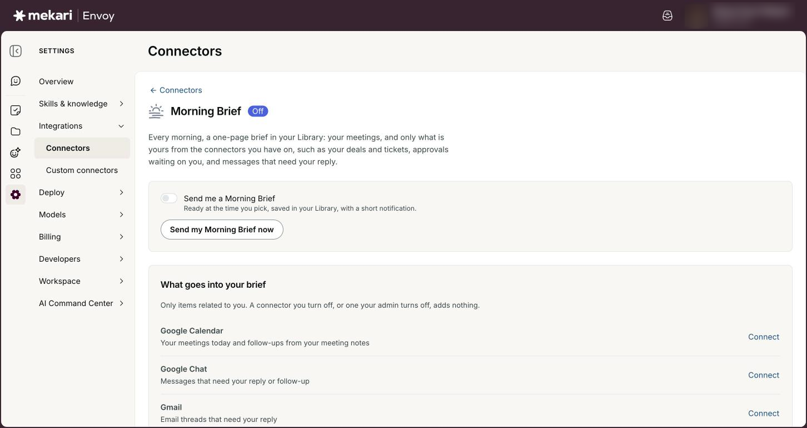

# Morning Brief & Meeting assistant


**General Guide** — for everyone, no technical knowledge needed.


| | |
|---|---|
| **Who this is for** | Everyone who uses Envoy with a Google Calendar |
| **Where to find it** | **Connectors** in the left rail, then the **Morning Brief** card (daily brief) or the **Google Calendar** card (**Meeting assistant**) |
| **Last checked** | 24 October 2026 |

## What it is

Envoy can get you ready for your day without you asking. The **Morning Brief** is a one-page brief that lands in your **Library** every morning: your meetings for the day, and only the things that are yours from the connectors you have on, such as your deals and tickets, approvals waiting on you, and messages that need your reply.

The **Meeting assistant** prepares you for each meeting. A little before it starts, Envoy reads the invite, the attached files and the notes from the last time you met, then posts a short brief in a chat named **Prep · <meeting title>**. You can keep asking Airene questions in that chat.

Both run only for you, with your own Google access, and both start from your Google Calendar. You can switch either one on or off at any time, and each works without the other.

## Before you start

* Connect Google Calendar with **Read** access in **Connectors**. Neither feature can be switched on without it.
* Optional: connect Google Drive so Envoy can read attached files, Gemini notes and Meet transcripts. Without it, files are listed but not read.
* Optional: connect the other tools you want in your Morning Brief, such as Qontak, Jurnal, Talenta, Gmail, Google Chat, Slack, Atlassian, HubSpot or Asana.

## How to use it

### Connect Google Calendar

1. Click **Connectors** in the left rail.
2. Click the **Google Calendar** card.
3. Under **Access**, tick **Read**.
4. Click **Connect Google Calendar** and finish the Google sign-in.


Once Calendar is connected, clicking the card opens its own page. To get back to the Meeting assistant, click **Actions**, then **Manage access**.


<figure><figcaption>
The Google Calendar panel before connecting, with the Read and Create and edit boxes.
</figcaption></figure>

### Turn on the Morning Brief

1. Click **Connectors** in the left rail, then click the **Morning Brief** card.
2. Turn on **Send me a Morning Brief**.
3. Pick a time in **Send it at**.
4. Leave **Weekdays only** ticked if you do not want a brief on Saturday and Sunday.
5. Check **What goes into your brief**. Each connector shows **Included**, **Not connected** or **Turned off by your admin**. Click **Connect** next to any you want to add.
6. Wait for **Saved** to appear. Changes save on their own.

<figure><figcaption>
Morning Brief settings and the connectors that feed your brief
</figcaption></figure>

### Read your Morning Brief

1. Open it from your Inbox, or click **Open the latest brief** on the **Morning Brief** page.
2. You can also find it in **Library**, named like **Morning brief - Thu, 23 Oct 2026**, and in a chat named like **Morning brief · Thu 23 Oct**.
3. Read the sections: **Push your work forward** (the one thing Envoy offers to help with first), **Top to-dos**, **New updates** and **Your day** (each meeting with a short note on what to read or bring).
4. If a source could not be checked, the bottom of the page says **Couldn't check this morning:** and names it.

### Chat about an item in your brief

1. Point at a to-do, an update or a meeting on the brief page.
2. Click **Chat about this**. A new chat opens, named after the item, starting with what the brief said about it and with that item's connector already attached.
3. Tell Airene what you want to do, for example draft a reply or check the details.
4. For a meeting that has not started yet, click **Prep for this meeting** instead. Envoy opens that meeting's **Prep · …** chat, and writes the brief first if it does not exist yet.


Clicking the same item again later takes you back to the chat it already opened. On a phone, or in the narrow preview beside a chat, tap the item itself; the **Chat about this** button is not shown there.


### Turn on the Meeting assistant

1. Click **Connectors** in the left rail, then **Google Calendar**.
2. Click **Actions**, then **Manage access**.
3. In the **Meeting assistant** section, turn on **Prepare me before meetings**.
4. Choose when to get the brief in **Send the brief**.
5. Choose which meetings get one in **Prepare for**.
6. Wait for **Saved** to appear.


Each brief arrives in its own chat named **Prep · <meeting title>**.


### Let Envoy read your files and meeting notes

1. In the **Meeting assistant** section, tick **Read attached files and last meeting's notes**.
2. If you see "Google Drive isn't connected, so files are listed but not read.", click **Allow Drive read**.
3. Approve Drive access on the Google screen. You come back to the Google Calendar settings.

### Get a brief right now

1. For your next meeting, click **Prepare my next meeting now** in the **Meeting assistant** section.
2. For today's Morning Brief, click **Send my Morning Brief now** on the **Morning Brief** page. This works at any time of day.
3. Watch **Recent briefs** in the **Meeting assistant** section. The badge changes from **Preparing** to **Ready**.
4. Click **Open** next to the brief.

## Your options

| Option | What it does |
|---|---|
| **Send me a Morning Brief** | Turns the daily brief on or off. Off by default. |
| **Send it at** | When the brief is ready: every half hour from 6:00 to 10:00. The default is 7:30. The time follows your Google Calendar's time zone. |
| **Weekdays only** | Ticked by default: no brief on Saturday or Sunday. Monday's brief covers Friday's meetings. |
| **Prepare me before meetings** | Turns the per-meeting brief on or off. Off by default. |
| **Send the brief** | How early the meeting brief arrives: **10 minutes before**, **15 minutes before**, **30 minutes before** (the default), **1 hour before** or **2 hours before**. |
| **Prepare for** | Which meetings get a brief. **Meetings with other people** (the default) skips meetings with no other guests. **Meetings with people outside my company** only covers meetings with guests from another company. **Every meeting, including solo blocks** covers everything on your calendar. |
| **Read attached files and last meeting's notes** | Ticked by default. Lets Envoy read Google Docs, Sheets and Slides, plain text files, Gemini notes and Meet transcripts to find decisions and open action items. PDFs, images and Word files are listed in the brief's sources but not read. Untick it and files are only listed by name. |

## Good to know

* Only items related to you go into your Morning Brief, such as a deal you own, a ticket assigned to you or an approval waiting on you. A connector you turn off, or one your admin turns off, adds nothing. From Talenta, the brief never includes salary, bank account, national ID or private HR file data.
* When it writes your Morning Brief, Envoy is told to only look things up, never to create, change or send anything. Personal details in files and notes are masked before the AI model reads them, and the brief keeps no email addresses and no links other than its own listed sources.
* A meeting brief is never made for a cancelled meeting, a meeting you declined, an all-day event, or out-of-office, focus time, working location and birthday entries.
* A meeting brief can start with heads-ups, for example: it overlaps another meeting you accepted, the invite has no agenda, the organiser or many guests declined, you have not replied yet, there are guests from another company, a pre-read changed in the last day, or the meeting was set up less than a day ahead. Links in the meeting description are only opened when the organiser is from your own company.
* A Morning Brief is not sent more than 2 hours after the time you picked. If you switch it on later than that, your first brief comes the next day.
* On a day with nothing on your calendar and no new meeting notes, no Morning Brief is sent. If you run it again the same day, Envoy updates the same Library page instead of making a second one, and meetings that are already over are left out.
* You get at most 12 scheduled meeting briefs a day. After that, a meeting shows **Skipped** with "Daily limit of 12 briefs reached."
* Briefs you start yourself (**Prepare my next meeting now**, **Send my Morning Brief now** and **Prep for this meeting**) share one limit: 3 every 10 minutes. **Prepare my next meeting now** looks up to 7 days ahead.
* Scheduled briefs add an item to your Inbox (see [Inbox & notifications](../guides/inbox-and-notifications.md)). Briefs you start yourself do not. While Envoy is open, a short message like "Prep ready: <meeting> at <time>" pops up with **Open**.
* **Recent briefs** shows your last 5 briefs. The record of each brief is kept for 90 days. If you disconnect Google, your Meeting assistant settings and brief history are deleted.
* The **Morning brief** button under **Daily routine** in a new chat is different: it asks Airene for a brief in that chat straight away. It is not the scheduled Morning Brief.

## Ideas to try

* Connect Qontak, then turn on the Morning Brief at 7:30 so deals closing today and tickets at risk are waiting for you when you start.
* Click **Chat about this** on a to-do and ask: "Draft a reply I can review and send."
* In a **Prep · …** chat, ask: "What did we decide last time, and which action items are still open?"
* Set **Prepare for** to **Meetings with people outside my company** if you only want help with client and partner calls.

## If something goes wrong

| What you see | What to do |
|---|---|
| "The Morning Brief starts from your Google Calendar. Connect Google with Calendar read access first." | Go to **Connectors**, click **Google Calendar**, tick **Read** and connect. |
| "Connect Google Calendar with read access first." when you switch a feature on | Connect Google Calendar with **Read** access, then try the switch again. |
| "Your Google connection expired, so no briefs are being prepared." | Click **Reconnect Google** and sign in to Google again. |
| "Google Drive isn't connected, so files are listed but not read." | Click **Allow Drive read**, or untick **Read attached files and last meeting's notes** if you do not want files read. |
| "You can prepare 3 briefs every 10 minutes. Try again shortly." | Wait a few minutes and try again. |
| "No meeting in the next 7 days matches your settings." | Check **Prepare for**. Meetings you declined, all-day events and solo blocks (unless you chose **Every meeting, including solo blocks**) are not picked. |
| A brief shows **Skipped** with "Nothing on your calendar and no new meeting notes, so nothing was sent." | Nothing to fix. Click **Send my Morning Brief now** if you still want one. |
| A brief shows **Ready, with gaps** | Some files or connectors could not be read. Open the brief to see what is missing, and check that those connectors are still connected. |
| A brief shows **Failed** with "Your company's AI budget is used up." or "Your company's AI data policy allows no model for this." | Ask your company admin. Both are company settings in **Company AI controls** (see [Company AI controls & Connector access](../for-admins/company-ai-controls-and-connector-access.md)). A brief that failed for the budget works again once the budget resets or is raised. |
| "Couldn't open this chat. Go back to your Library and try again." | Open the brief again from **Library** and click the item once more. |

## Related guides

* [Connectors (connect your apps)](../guides/connectors.md)
* [Library](../guides/library.md)
* [Inbox & notifications](../guides/inbox-and-notifications.md)
* [Chatting with Airene](../guides/chatting-with-airene.md)
* [Your AI data & memory](../guides/your-ai-data-and-memory.md)
* [Company AI controls & Connector access](../for-admins/company-ai-controls-and-connector-access.md)
