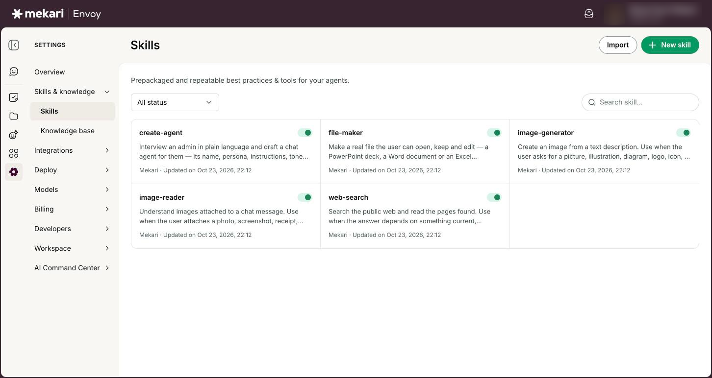
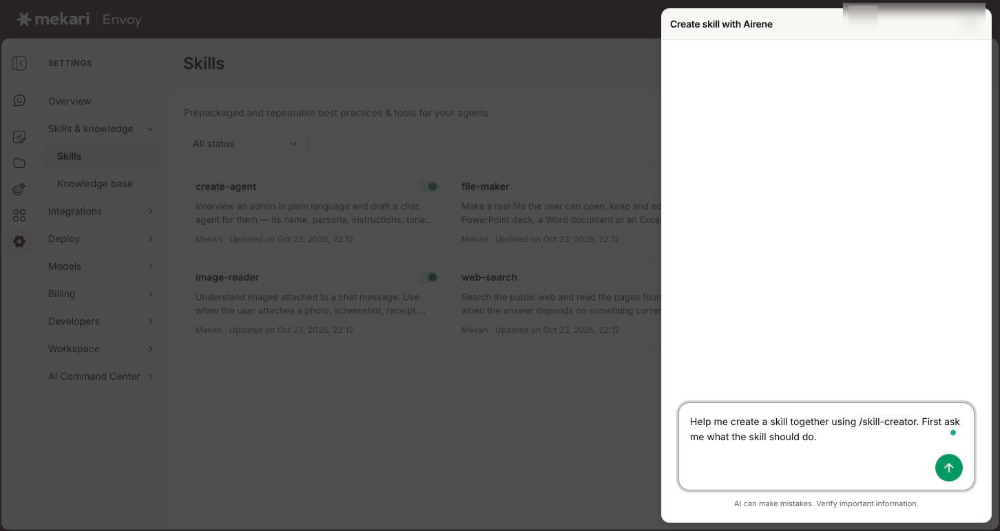
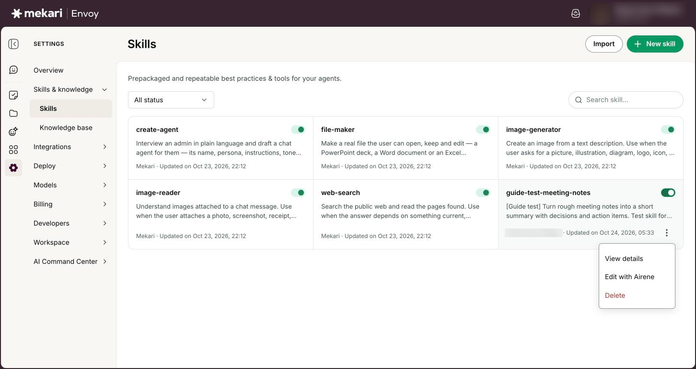
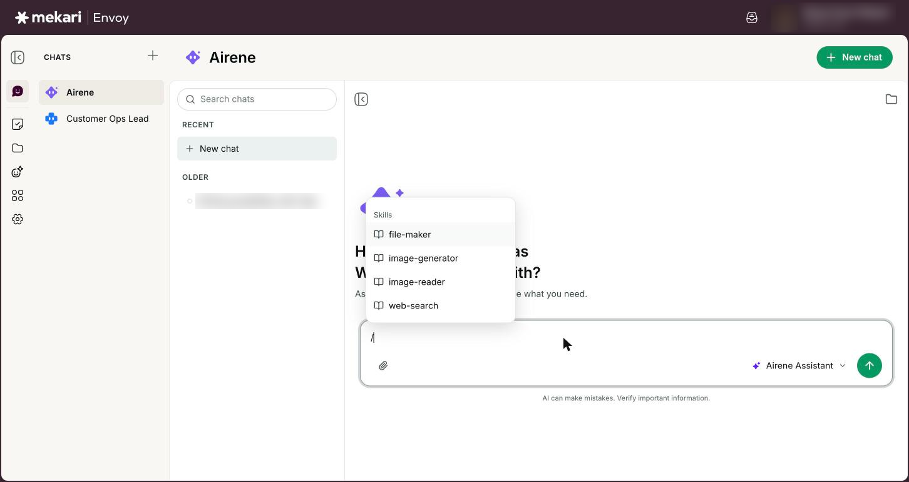
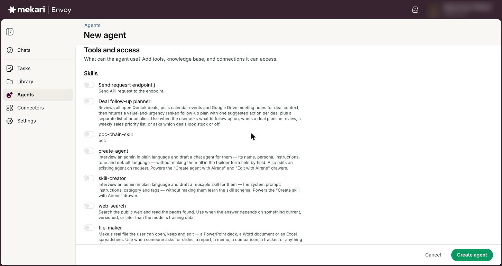
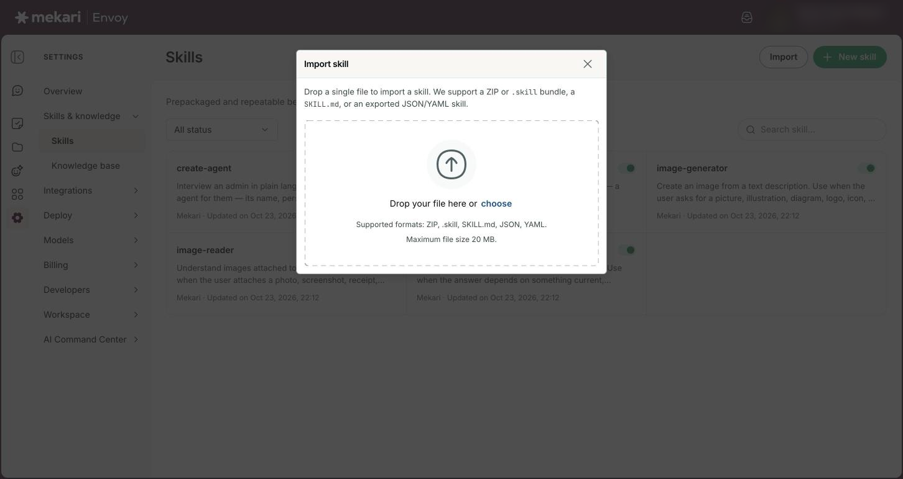

# Skills


**General Guide** — for everyone, no technical knowledge needed.


| | |
|---|---|
| **Who this is for** | Everyone who uses Envoy; creating and editing skills needs the Member or Admin role |
| **Where to find it** | **Settings** in the left rail, then **Skills** (under **Skills & knowledge**) |
| **Last checked** | 24 October 2026 |

## What it is

A skill is a prepackaged, repeatable best practice for Airene and your agents. It bundles instructions, and sometimes tools, for one kind of job, such as reading images, making files or writing in your team's house style.

Envoy comes with skills made by Mekari, and you can create your own by talking to Airene. You can then use a skill in any chat by typing /, or switch it on for an agent so the agent always uses it.

## Before you start

* Anyone can browse skills. You need the **Member** or **Admin** role to create, change, switch off or delete them.
* Think about one clear job the skill should do and an example of a good result. Airene will ask you about both.

## How to use it

### Browse skills

1. Click **Settings** in the left rail, then **Skills**.
2. Use the status filter to show **All status**, **On** or **Off** skills.
3. Type in **Search skill...** to find a skill by name.
4. Click a skill's card to see its details: **Instructions**, **Tools** and, where there are any, **Hooks**.


Each card shows who made it (**Mekari** for built-in skills) and when it was last updated.


<figure><figcaption>
The Skills page
</figcaption></figure>

### Create a skill with Airene

1. Click **New skill**. The **Create skill with Airene** panel opens with a message ready to send.
2. Press Enter to send it. Airene asks what the skill should do.
3. Answer Airene's questions in plain words. Airene drafts the skill and shows it as a card.
4. Click **Add to skills** on the card. Your new skill appears in the list, highlighted.


If you close the panel before adding the skill, the conversation is kept. You see **Chat saved in Chats › Airene** with an **Open** button.


<figure><figcaption>
Creating a skill with Airene
</figcaption></figure>

### Change a skill with Airene

1. Find your skill and click its options button (the three dots).
2. Click **Edit with Airene**. The **Edit skill with Airene** panel opens.
3. Tell Airene what to change.
4. Click **Update skill** on the card Airene shows you.


Built-in Mekari skills cannot be edited.


<figure><figcaption>
Options for a skill you made
</figcaption></figure>

### Switch a skill on or off

1. Find the skill in the list.
2. Click the switch on its card. You see a message that it was turned on or off.


A switched-off skill is not used in chats or by agents until you switch it on again. Built-in Mekari skills are always on.


<figure><figcaption>
Switching a skill on or off
</figcaption></figure>

### Use a skill in a chat

1. In any chat, type / in the message box. The **Skills and tools** menu opens.
2. Keep typing to filter, or use the arrow keys.
3. Press Enter or Tab to pick a skill. It is added to your message.
4. Finish your message and send it.

<figure><figcaption>
Picking a skill in a chat
</figcaption></figure>

### Give a skill to an agent

1. Click **Agents** in the left rail and open the agent.
2. Click **Actions**, then **Edit**.
3. Under **Tools and access**, then **Skills**, switch on the skill.
4. Click **Save changes**.


An agent only uses the skills you switch on for it, so add built-in skills such as **image-reader** to an agent if it needs them.


<figure><figcaption>
Giving a skill to an agent
</figcaption></figure>

### Import or delete a skill

1. To import, click **Import**, drop in a skill file or ZIP bundle someone exported (the window lists the file types it accepts), review what will be imported, then click the import button.
2. If the bundle runs commands on the system, read the warning, tick **I have reviewed these hook commands and approve their execution**, then import.
3. To delete one of your skills, open its options (the three dots), click **Delete** and confirm.

<figure><figcaption>
Importing a skill
</figcaption></figure>

## Your options

| Option | What it does |
|---|---|
| **image-reader** | Built-in. Reads images attached to a message, such as photos, screenshots, receipts and scans, so the assistant can answer questions about them. |
| **image-generator** | Built-in. Creates an image from a text description, for example an illustration, icon or mockup. |
| **file-maker** | Built-in. Makes real files you can keep: a PowerPoint deck, a Word document or an Excel spreadsheet. The files land in your **Library** (see [Library](../guides/library.md)). |
| **web-search** | Built-in. Searches the public web and reads the pages it finds, for questions about current or recent information. It only works when the Envoy team has switched web search on for everyone, so it may not be available to you. |
| **View details** | Opens the skill's details, including its instructions and any tools it carries. |
| **Hooks** | Commands some imported skills run on the system at certain moments. They need your explicit approval when you import. |

## Good to know

* In a chat with Airene, the built-in skills are used automatically when they fit. You do not need to pick them with /.
* Your company can have up to 100 custom skills. When you reach that, you see **You've reached the limit of 100 skills**; delete a skill you no longer need to make room.
* You can change, switch off or delete skills you made. Your company admins can change any custom skill.
* Imported files can be up to 20 MB, and one bundle can hold up to 20 skills.
* A custom skill whose maker has left the company shows **Former user** as its owner.
* Built-in skills show **Mekari skills can't be turned off yet** if you try to switch them off.

## Ideas to try

* Click **New skill** and tell Airene: "Write customer emails in our brand voice: warm, short, no jargon, always end with a clear next step."
* Create a skill that turns meeting notes into a summary with decisions, owners and due dates, then type / in a chat to use it.
* Switch on **file-maker** for an agent that should hand people a finished deck or spreadsheet, not just text.

## If something goes wrong

| What you see | What to do |
|---|---|
| "Couldn't update" a skill when you switch it | Try again. If it keeps failing, you may not own the skill; ask its maker or an admin. |
| **Unsupported file. Drop a ZIP, .skill, SKILL.md, JSON, or YAML file.** | Import one of those file types. A SKILL.md file must start with a short header block, between two --- lines, that gives the skill a name and a description; otherwise you see "The SKILL.md must define a name and a description in its YAML frontmatter." |
| "File too large — the maximum size is 20 MB." | Split the bundle into smaller ones and import them one at a time. |
| "This bundle has more than 20 skills. Split it and import again." | Split the bundle so each one holds 20 skills or fewer. |
| The skill you want is missing from the / menu. | Check the skill is switched **On** on the Skills page, then type / again. |

## Related guides

* [Chatting with Airene](../guides/chatting-with-airene.md)
* [Agents](../guides/agents.md)
* [Library](../guides/library.md)
