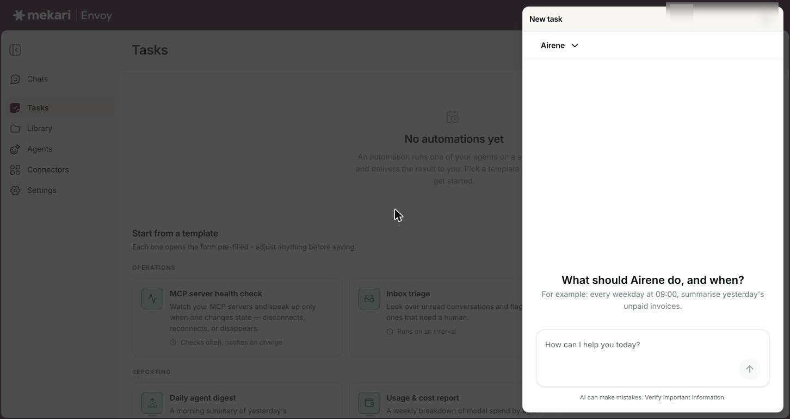
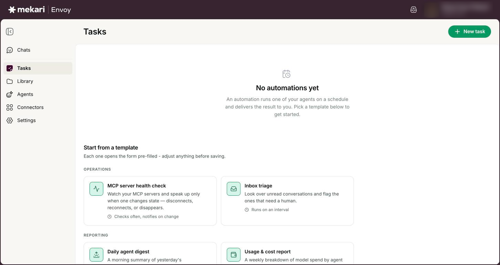
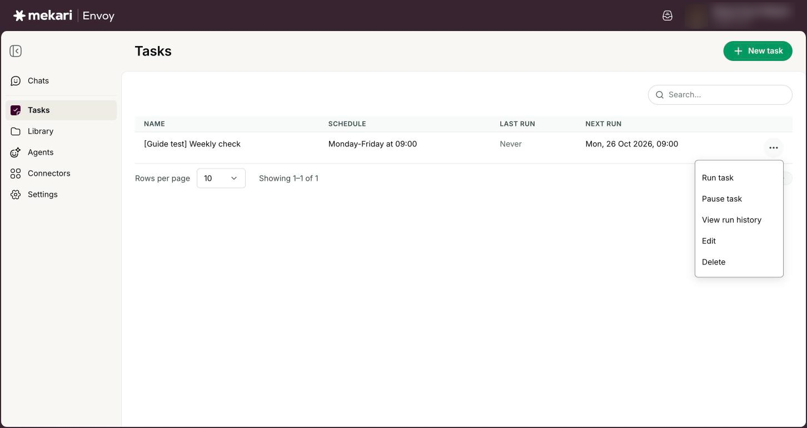
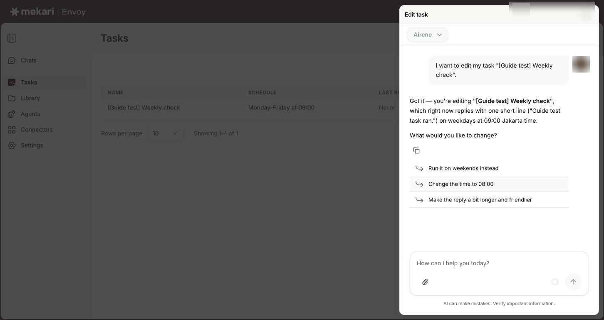
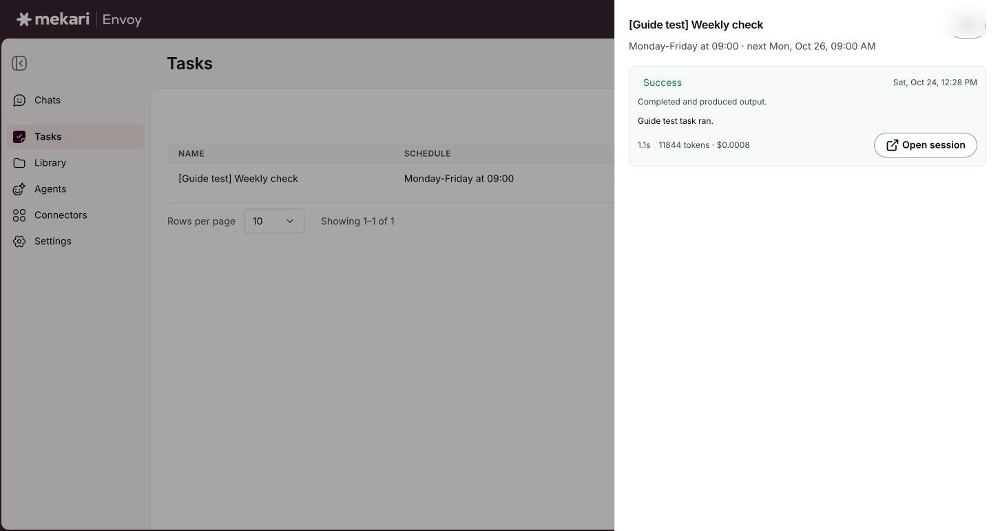

# Tasks


**General Guide** — for everyone, no technical knowledge needed.


| | |
|---|---|
| **Who this is for** | Everyone who uses Envoy |
| **Where to find it** | **Tasks** in the left rail |
| **Last checked** | 24 October 2026 |

## What it is

A task is a piece of recurring work that Airene, or one of your agents, does for you on a schedule. You write the instruction once, for example "summarise yesterday's unpaid invoices", choose when it should run, and each run's result comes back to you in chat.

You can set up a task in three ways: describe it in plain words with **New task**, ask for it in any chat, or start from a ready-made template. A task can also watch something and only run when it changes, which saves time and costs nothing while nothing happens.

Envoy sometimes calls tasks "automations". You will see that word in some messages, for example **Automation created**. They mean the same thing.

## Before you start

* Sign in to Envoy with your Mekari sign-in.
* Decide which assistant should do the work. You can use Airene (shown as **Default assistant** in the form) or one of your own agents. An agent that is still a draft cannot run a task, so finish creating it first (see [Agents](../guides/agents.md)).
* Connect any app the task needs, such as your email or calendar, in **Connectors** (see [Connectors (connect your apps)](../guides/connectors.md)). A run happens with nobody watching, so it cannot stop and ask you to connect something.
* Know which time zone the schedule should follow, especially if you work across regions.

## How to use it

### Create a task by describing it

1. Click **Tasks** in the left rail.
2. Click **New task** at the top right. A **New task** panel opens with a chat box.
3. Optional: use the picker at the top of the panel to choose which agent the task runs as. Airene is the default. The picker locks once you send your first message.
4. Type what the task should do and when, for example: every weekday at 09:00, summarise yesterday's unpaid invoices.
5. Answer any follow-up question. A confirmation card then shows the task's name, schedule and instruction.
6. Check the card, then click **Confirm**. If an **Edit** button shows, you can use it to change a value first, or click **Cancel** to stop.
7. Close the panel. Your new task now appears in the table.


If you close the panel before a task was created, the conversation is kept. A message says **Chat saved in Chats** with an **Open** button.


<figure><figcaption>
The New task panel, where you describe a task in plain words
</figcaption></figure>

### Create a task from any chat

1. In any chat, ask for a scheduled job in plain words, for example: "Every Monday at 08:00, send me a summary of last week's new deals."
2. Check the confirmation card that appears, then click **Confirm**.
3. Look for the message that says the automation was created and when it runs next. Click **View** to open **Tasks**.
4. When the task runs, its result comes back to this same chat, marked **Scheduled run:** followed by the task name. You can reply to it like any other message.


This is the only way to create a one-off reminder, such as "remind me tomorrow at 10:00". If you do not mention a time zone, a task created in chat uses Jakarta time (Asia/Jakarta). If you delete the chat, later runs get a conversation of their own.


<figure><figcaption>
A task request from chat waits on an approval card with Deny, Edit and Approve.
</figcaption></figure>

### Start from a template or from scratch

1. Open **Tasks** while you have no tasks yet. Below **No automations yet** you see **Start from a template**.
2. Pick a template card. Each card says how often it runs, for example **Runs every day** or **Checks often, notifies on change**.
3. Adjust the choices under **Template settings**. Changing them rewrites the instruction for you.
4. Or click **Start from scratch** to fill in an empty form yourself.
5. Fill in **Name**, **What should the agent do?** and **Run as which agent?**.
6. Choose a **Schedule** and check the **Timezone**. The summary below shows the next run times.
7. Choose **When to run** and **Where results go** (see the options below).
8. Click **Create automation**.


The templates only show while your task list is empty. Once you have a task, use **New task** instead.


<figure><figcaption>
With no tasks yet, the Tasks page shows the Start from a template gallery.
</figcaption></figure>

### Run, pause, or delete a task

1. Find the task in the table. Use **Search tasks** if the list is long.
2. Click the **...** button at the end of its row.
3. Click **Run task** to run it now instead of waiting. You see **Run started**, and the run begins within about a minute.
4. Click **Pause task** to stop it running on schedule. The row shows **Paused**. Click **Resume task** to switch it back on.
5. Click **Open chat** to go to the conversation where its results land. This only shows when all runs share one conversation.
6. Click **Delete**, then confirm, to remove the task for good.


Running a paused task with **Run task** also switches it back on. You cannot stop a run that has already started: it finishes on its own, or stops after 10 minutes with **Timed out**. **Pause task** only stops future runs.


<figure><figcaption>
The options menu on a task row: Run task, Pause task, View run history, Edit and Delete.
</figcaption></figure>

### Change a task by chatting

1. Click the **...** button on the task's row, then click **Edit**.
2. The **Edit task** panel opens on the task's own chat. The agent names the task, asks what you want to change and offers a few likely changes you can click.
3. Say what to change, for example "Run it on weekdays only".
4. Read the card that appears. It shows the task name and what changed, such as **Schedule updated** or **Instruction updated**.
5. Click **Apply changes**. The card changes to **Applied** and you see **Changes saved**.


Nothing is saved until you click **Apply changes**. From chat you can change the name, description, instruction and schedule. To change anything else, such as which agent runs it or where results go, create a new task.


<figure><figcaption>
Edit task opens a chat with Airene and suggests common changes.
</figcaption></figure>

### Check how a task has been running

1. Look at the **Last run** column for the latest result, and **Next run** for when it runs again.
2. Click the **...** button on the task's row, then click **View run history**.
3. Read each run: its status, when it ran, a one-line explanation, any error, the start of its result and how long it took.
4. Click **Open session** on a run to read its full result in chat.


The panel shows the 20 most recent runs and refreshes itself while a run is still in progress.


<figure><figcaption>
Run history: each run with its status, result and an Open session button.
</figcaption></figure>

### Add or dismiss a suggested task

1. Look for suggestion cards at the top of **Tasks**. Envoy offers these when your company has no tasks yet, or after someone adds a new connection or knowledge collection.
2. Click **Add it** to create the task straight away. You see **Automation created**.
3. Or click **Dismiss** to hide the suggestion.

## Your options

| Option | What it does |
|---|---|
| **Name** | What the task is called in the table and in your notifications. It must not match another task's name in your company, even with different capital letters. |
| **What should the agent do?** | The instruction the agent follows on every run. Write it as if you were asking in chat, and include every detail it needs, because the run cannot ask you questions. |
| **Run as which agent?** | Who does the work. **Default assistant** runs it like a new chat with Airene. Picking an agent uses that agent's AI model, skills and knowledge, shown under **Capabilities**. If you later change the agent, the task's next run changes too. |
| **How should it be invoked?** | Leave this on **Chat**, the normal choice: the task runs like a chat with the agent. **A2A task** is for technical users and only works with agents set up to be called by other agents; their names show **· A2A** in the agent list. |
| **Schedule** | How often the task runs. **Every** runs it every set number of minutes, hours or days. **Daily**, **Weekly** and **Monthly** run it at a set time, on the days you pick. **Advanced (cron)** is a custom pattern for technical users; ask your admin if you need one. |
| **Timezone** | The time zone the schedule follows. The form fills in your computer's time zone. The summary under it shows the next run times so you can check them. |
| **When to run** | Monitor mode. **Always run the agent** runs it every time. **Only when a tracked number changes** and **Only when a web page changes** do a quick check first, and if nothing changed the agent is skipped and the run costs nothing. There is also an option that watches whether your connectors are still connected. A web page to watch must be a public https address. |
| **Keep the result in chat** | Under **Where results go**. Each run leaves a conversation you can open and read in full. Only you see it. Turn this off and the run history keeps only the first 2,000 characters of each result. |
| **Keep all runs in one conversation** | On by default. Every run continues the same conversation, so the agent can see what it reported last time. Turn it off to start a new conversation for each run. |
| **Also POST the result to a webhook** | Sends each result to another system as well. This is for technical users; ask your admin before you turn it on. |
| **Queued** / **Running** / **Success** / **Partial** | Run status: about to start, working now, or finished with a result. **Partial** means some steps failed, so the answer may be incomplete. |
| **No change** / **Nothing new to report** | Run status for watching tasks: nothing changed since the last check, so the agent did not run (no cost), or it compared this run with the last one and found nothing new. These are normal and send no notification. |
| **Needs reconnect** / **Error** / **Timed out** / **Interrupted** | Run status: a connector the task needs must be reconnected; the run failed (see the error in run history); it ran past 10 minutes and was stopped; or it was cut off before finishing. An interrupted run is not retried, because it may already have done part of its work. |

## Good to know

* A run happens with nobody watching, so there is no **Confirm** card. If the instruction asks for a change in a connected app, such as updating a record or creating a calendar event, the task makes it straight away. Only ask a task to make changes you are happy to have made without checking first, and try it with **Run task** before you rely on it.
* A task can only send email to addresses written in its own instruction. This applies to every task, however it was created. Tasks also cannot use Microsoft SharePoint or change slide decks that already exist; ask for those in a normal chat.
* Your tasks are personal. Only you see your tasks, their run history and the conversations they leave.
* Suggested tasks are shared across your company. Once anyone clicks **Add it** or **Dismiss**, the card goes away for everyone, and a dismissed suggestion is never offered again.
* A schedule can run as often as every minute. A monthly task set for the 29th, 30th or 31st skips months that do not have that day.
* A task always starts on its schedule. It cannot start the moment something happens in another app. To react quickly, use a watching task that checks often, such as **Only when a tracked number changes**.
* Each run can take up to 10 minutes. After that it stops with the status **Timed out**. Every run that uses the AI counts toward your company's AI budget, so a task that runs every few minutes can use a lot. A watching task that finds no change costs nothing.
* Run history is kept for 30 days, and **View run history** shows the latest 20 runs. Deleting a task also deletes its run history for good.
* You get a notification for every run that produces a result and for every failed run (**Automation failed ·** followed by the task name). Quiet outcomes such as **No change** send nothing. See [Inbox & notifications](../guides/inbox-and-notifications.md).
* You can create up to 3 tasks in one chat message. A task can never create or change other tasks; only people manage tasks.

## Ideas to try

* Ask: "Every weekday at 09:00, summarise yesterday's unpaid invoices."
* Ask: "Remind me tomorrow at 10:00 to send the weekly sales report."
* Try the **Daily agent digest** template for a morning summary of what one of your agents handled in the last 24 hours.
* Set **When to run** to **Only when a web page changes** to get told only when a public status or price page changes.

## If something goes wrong

| What you see | What to do |
|---|---|
| "An automation named '...' already exists." | Task names must be different across your whole company. Pick a more specific name, for example add your team or the day it runs. |
| The **Create automation** button stays greyed out | Check that **Name** and **What should the agent do?** are filled in, that the schedule summary shows next run times instead of a red message, and that at least one box under **Where results go** is ticked. |
| "This schedule has no upcoming runs." | The schedule never fires again, for example a one-off time already in the past. Choose a future time or a repeating schedule. |
| A run shows **Needs reconnect** | Open **Connectors**, reconnect the app the task uses (see [Connectors (connect your apps)](../guides/connectors.md)), then use **Run task** to run it again. |
| A run result says "Not sent: an automation may only email the addresses written in its own instructions" | The task tried to email someone whose address is not in its instruction. Click **Edit** on the task and ask for the full email address to be added to the instruction, then use **Run task**. |
| A run fails with "The AI budget ran out before this run finished." | Your company's AI budget is used up. Tasks run normally again once the budget resets or an admin raises it (see [Company AI controls & Connector access](../for-admins/company-ai-controls-and-connector-access.md)). |
| A run shows **Interrupted** | It was not retried on purpose. Check whether it already did its work, for example sent an email, before you use **Run task** again. |
| **Run task** fails with a message that the task "already has a run in progress" | Only one run of a task can happen at a time. Wait for the current run to finish, then try again. |
| Your agent is missing from **Run as which agent?**, or a task shows **Paused** because its agent "is still a draft" | Drafts are not listed and cannot run tasks. Finish creating the agent (see [Agents](../guides/agents.md)), or choose another agent, then click **Resume task** on a paused task. You are notified about a paused task once, not on every run. |
| You see your tasks but not **New task**, **Run task**, **Edit** or **Delete** | Your account has view-only access, which only allows **View run history**. Ask your admin if you need to create or change tasks. |

## Related guides

* [Chatting with Airene](../guides/chatting-with-airene.md)
* [Agents](../guides/agents.md)
* [Connectors (connect your apps)](../guides/connectors.md)
* [Inbox & notifications](../guides/inbox-and-notifications.md)
* [Knowledge base](../guides/knowledge-base.md)
* [Company AI controls & Connector access](../for-admins/company-ai-controls-and-connector-access.md)
