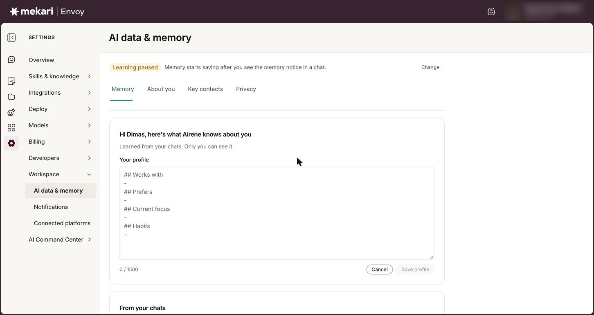
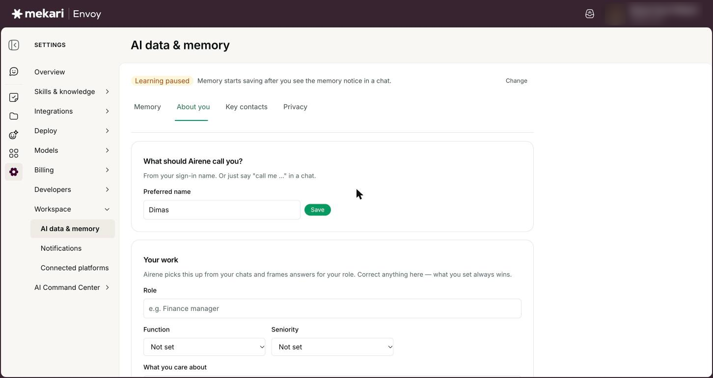
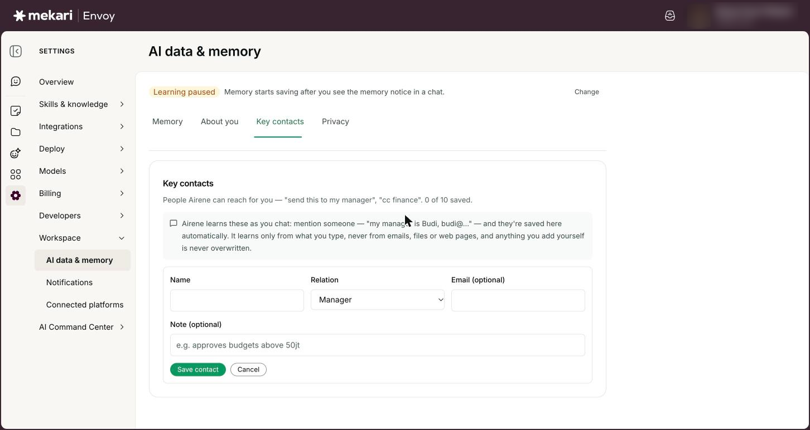
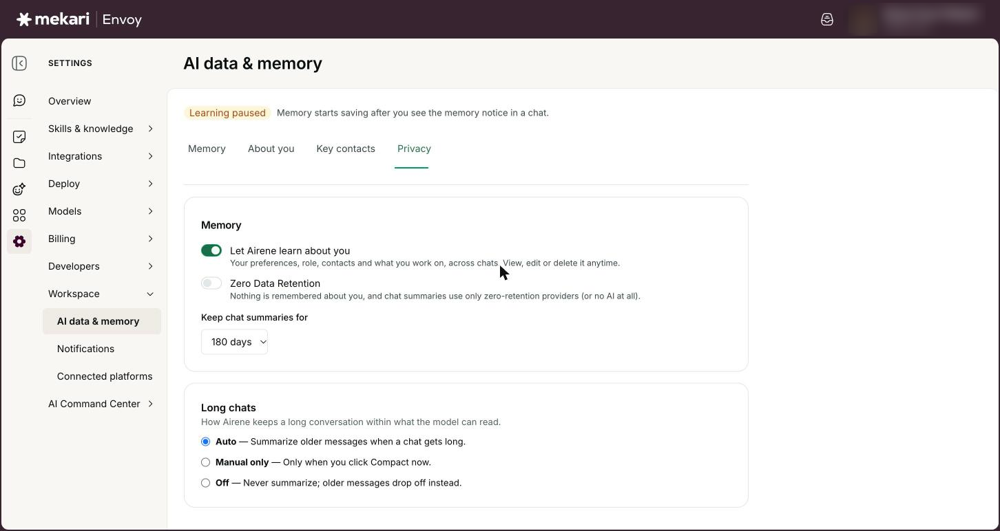
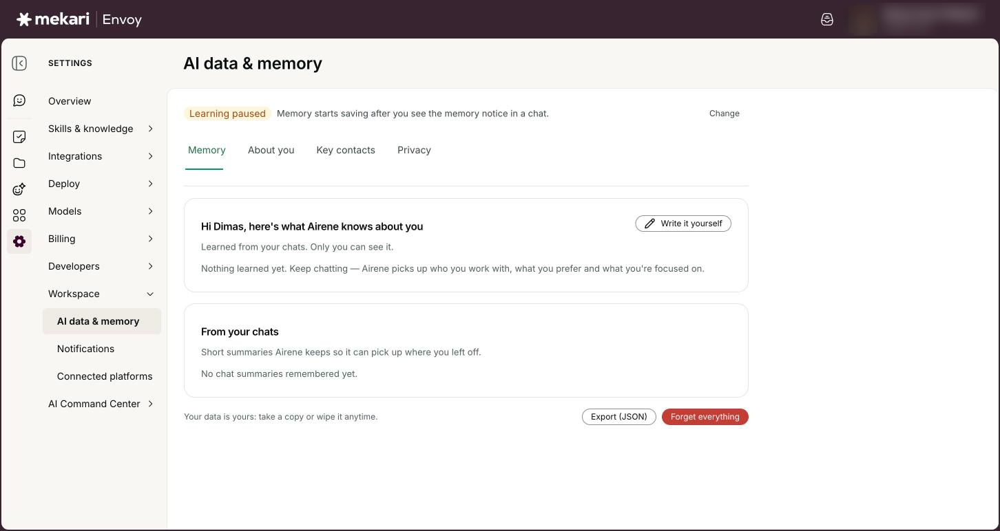
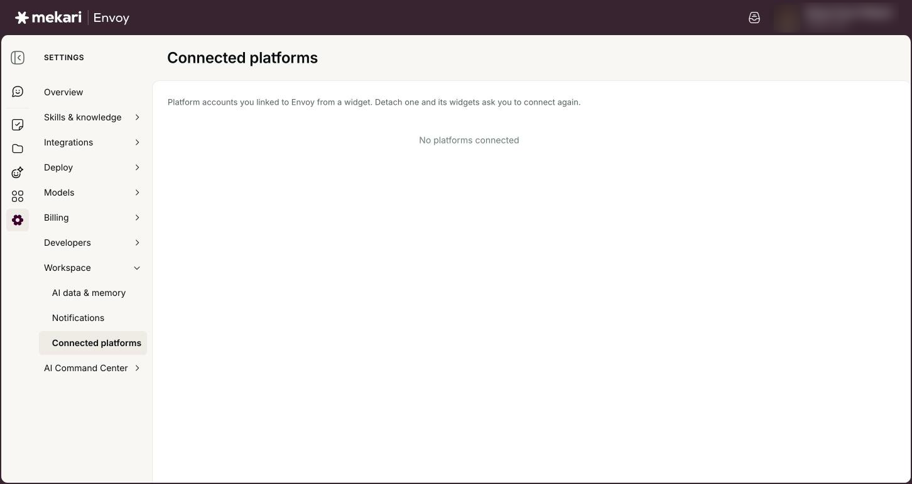

# Your AI data & memory


**General Guide** — for everyone, no technical knowledge needed.


| | |
|---|---|
| **Who this is for** | Everyone who uses Envoy |
| **Where to find it** | **Settings** in the left rail, then **AI data & memory** (under **Workspace**). Connected platforms is in the same list: **Settings**, then **Connected platforms**. |
| **Last checked** | 24 October 2026 |

## What it is

Airene can remember things about you across chats: who you work with, how you like answers, what you are focused on, and short summaries of past chats so it can pick up where you left off. The **AI data & memory** page is where you see all of it, correct it, download it or delete it. Only you can see it.

The page has four tabs. **Memory** shows what Airene has learned and the summaries it keeps. **About you** holds your preferred name, your work details and your answer style. **Key contacts** lists the people Airene can reach for you. **Privacy** holds the switches: memory on or off, **Zero Data Retention**, how long chat summaries are kept, and how long chats are handled.

Your company admin can set limits for everyone in the company, for example a shorter keep period or memory turned off. When that happens you see a lock and the words **Set by your company admin**. Admin settings are covered in [Company AI controls & Connector access](../for-admins/company-ai-controls-and-connector-access.md).

## Before you start

* You only need to be signed in to Envoy. Every person, whatever their role, manages their own AI data.
* These settings are personal and apply to you in the company you are signed in to.
* If you plan to turn memory off, export a copy first. Turning it off deletes what Airene remembered.

## How to use it

### Check what Airene remembers about you

1. Go to **Settings**, then **AI data & memory**. The **Memory** tab opens first.
2. Read the badge at the top: **Learning on**, **Learning off** or **Learning paused**. The sentence next to it says why. Click **Change** to jump to the **Privacy** tab.
3. Look at the profile card. It is split into **Works with**, **Prefers**, **Current focus** and **Habits**. A section with nothing in it shows **Nothing yet**.
4. Scroll to **From your chats** to see the short summaries Airene keeps. Click a chat name to open that chat, or **Show more** to read a long summary.
5. To remove one summary, click the bin icon next to it.


Each summary shows a **Forgotten on** date: that is the day it is deleted automatically. If the badge says **Learning paused**, Airene is not adding chat summaries or updating your profile on its own right now (see Troubleshooting).


<figure><figcaption>
What Airene remembers about you, on the Memory tab
</figcaption></figure>

### See memory at work in a chat

1. Look under an answer for a small line that starts with **Used memory from:**. It names the earlier chats Airene drew on. Click a chat name to open it, or **Manage** to open **AI data & memory**.
2. When you mention a new contact, Airene may ask, for example, "Save Rina (Manager) to your contacts?" Click **Save** or **No**. Nothing is saved until you click.
3. After something is saved you see a line such as "Saved: I'll call you Ani" or "Saved Rina (Manager) to your contacts".
4. Click **Undo** on a saved contact to remove it straight away, or **Manage** to change it on the **Key contacts** tab.


These lines only appear in your own chats with memory on.


### Edit your profile yourself

1. On the **Memory** tab, click **Edit** (or **Write it yourself** if nothing has been learned yet).
2. Change the text in **Your profile**. Keep the four headings and put one point per line under each.
3. Click **Save profile**. Click **Cancel** to leave without saving.
4. To go back to an earlier version, open **Version history** while editing and click **Restore** next to the version you want.


What you write always wins over what Airene learned. Your profile can hold up to 1,500 characters.


<figure><figcaption>
Editing your profile yourself
</figcaption></figure>

### Tell Airene your name and how you like answers

1. Open the **About you** tab.
2. Under **What should Airene call you?**, type a **Preferred name** and click **Save**. Click **Reset** to go back to the name Envoy takes from your Mekari sign-in or email address.
3. In **Your work**, fill in **Role**, pick a **Function** and **Seniority**, and list up to 3 things in **What you care about**, separated by commas.
4. In **Answer style**, pick a choice for **Length**, **Format**, **Technical depth**, **Language** and **Tone**. Leave one on **Auto** and Airene learns it from how you chat.
5. Check the preview sentence under the choices, then click **Save** in the bar at the bottom. Click **Discard** to undo your changes.


You can also just say "call me ..." in a chat.


<figure><figcaption>
Your preferred name, work details and answer style
</figcaption></figure>

### Add or remove key contacts

1. Open the **Key contacts** tab and click **Add contact**.
2. Type the **Name**, choose a **Relation** (for example **Manager**, **Finance PIC** or **Client**), and add an **Email (optional)** and a **Note (optional)**. If you choose **Other**, fill in **Relation label**.
3. Click **Save contact**.
4. To change a contact, click **Edit**. To delete one, click **Remove**, then **Remove** again to confirm.


Contacts let you say things like "send this to my manager" or "cc finance" in a chat.


<figure><figcaption>
Adding a key contact
</figcaption></figure>

### Choose your privacy settings

1. Open the **Privacy** tab.
2. Use **Let Airene learn about you** to turn memory on or off. Turning it off asks you to confirm with **Turn it off and delete**.
3. Turn on **Zero Data Retention** if you want nothing remembered at all. This also asks you to confirm with **Turn it off and delete**.
4. Pick how long summaries stay in **Keep chat summaries for**.
5. Under **Long chats**, choose **Auto**, **Manual only** or **Off**. Each change saves straight away.

<figure><figcaption>
Your memory and privacy switches
</figcaption></figure>

### Download or delete everything

1. Go to the bottom of the **Memory** tab.
2. Click **Export (JSON)** to download a file with everything Airene keeps about you: your profile, earlier versions, chat summaries, contacts and preferred name.
3. Click **Forget everything** to wipe it all, then click **Forget everything** again to confirm.


Forget everything cannot be undone. Export first if you might want the information later.


<figure><figcaption>
Exporting or wiping everything Airene keeps about you
</figcaption></figure>

### Check your connected platforms

1. Go to **Settings**, then **Connected platforms**.
2. Read the table. It shows each **Platform** (for example **Mekari** or **Qontak CRM**), the **Company**, **Since** (the date you linked it), **Last used** and **Status**.
3. Check the **Status**: **Active** means the link works, **Detached** means you unlinked it, and **Turned off by admin** means only an admin can switch it back on.
4. To unlink one, click **Detach** on its row, then **Detach** again to confirm.
5. If nothing is linked, you see **No platforms connected**.


These are the accounts you linked to Envoy from the Envoy chat inside another Mekari product (see [Envoy inside Mekari products](../guides/envoy-inside-mekari-products.md)). After you detach one, that chat asks you to connect again before it answers.


<figure><figcaption>
Connected platforms (empty until you link an account from a widget).
</figcaption></figure>

## Your options

| Option | What it does |
|---|---|
| **Let Airene learn about you** | Memory on or off. On, Airene learns "Your preferences, role, contacts and what you work on, across chats." Off, nothing is learned, and your profile, chat summaries, contacts and preferred name are deleted. |
| **Zero Data Retention** | The strictest setting: "Nothing is remembered about you, and chat summaries use only zero-retention providers (or no AI at all)." Turning it on also turns memory off and deletes what was remembered. Chats then show a **ZDR** tag. |
| **Keep chat summaries for** | How long each chat summary is kept before it is deleted: 30, 60, 90, 120 or 180 days. The default is 180 days. The period is set when a summary is saved, and each one shows its own **Forgotten on** date. |
| **Long chats** | **Auto** (the default): when a chat gets long, Airene summarizes the older messages so the chat can keep going. **Manual only**: only when you click **Compact conversation** in the chat's **Context window** meter (from 6 messages). **Off**: older messages drop off instead; if your company does not allow Off, Airene uses **Manual only**. |
| **Answer style** | **Length** (**Brief**, **Balanced**, **Detailed**), **Format** (**Bullets**, **Prose**, **Tables first**), **Technical depth** (**Low**, **Medium**, **High**), **Language** (**Bahasa Indonesia**, **English**) and **Tone** (**Formal**, **Casual**). **Auto** lets Airene learn it. A **Learned** or **From chat** badge marks values Airene picked up itself. |

## Good to know

* Only you can see your memory. It belongs to you in the company you are signed in to.
* Memory is used only in your own chats. A chat started with **Incognito** switched on shows an **Incognito** tag and is not used for memory. Tasks that run by themselves and chats someone else owns do not use or add to your memory either. If your company has the Envoy chat switched on inside another Mekari product and you have connected it (see [Envoy inside Mekari products](../guides/envoy-inside-mekari-products.md)), your memory works there too.
* Airene learns contacts only from what you type, never from emails, files or web pages. Anything you add yourself is never overwritten.
* Limits: your profile holds up to 1,500 characters (up to 8 points per section, 120 characters each), you can save up to 10 key contacts, a preferred name is up to 40 characters, and a role is up to 60 characters.
* Memory never stores sensitive data such as salary, health, religion, ID numbers (NIK/KTP, NPWP, passport) or bank account numbers. Links, email addresses and phone numbers are also kept out of your profile.
* Chat summaries are kept for 30 to 180 days (180 by default). Your company can set a shorter maximum. Then longer choices disappear, the company limit itself may appear as a choice, and you see "Your company keeps chat summaries for at most" followed by the number of days. If your company lowers the limit, summaries you already have are shortened to match.
* Deleting a chat also deletes its summary. If you do not use Envoy chats for 365 days, everything Airene remembered about you is deleted.
* Turning memory off, turning on **Zero Data Retention** or clicking **Forget everything** deletes your profile, earlier versions, chat summaries, key contacts and preferred name. If your company admin turns memory off or turns on Zero Data Retention for the whole company, the same happens for everyone (see [Company AI controls & Connector access](../for-admins/company-ai-controls-and-connector-access.md)).
* You can export up to 5 times a day and save profile edits up to 20 times an hour.

## Ideas to try

* Say in a chat: "Call me Dimas" and check that **What should Airene call you?** now shows it.
* Tell Airene: "My manager is Budi, budi@..." and look for Budi on the **Key contacts** tab with a **Learned** badge.
* Set **Length** to **Brief** and **Format** to **Bullets** in **Answer style**, then ask the same question again and compare.
* Before a big change of role, open **Edit** on the **Memory** tab and update **Current focus** yourself.

## If something goes wrong

| What you see | What to do |
|---|---|
| The **About you** or **Key contacts** tab shows "Memory is off". | Click **Open privacy settings** and switch on **Let Airene learn about you**. If **Zero Data Retention** is on, turn it off first. |
| "Your company admin has locked this setting." or a lock with **Set by your company admin**. | Your company has fixed this setting for everyone, so you cannot change it here. Ask your company admin (see [Company AI controls & Connector access](../for-admins/company-ai-controls-and-connector-access.md)). |
| "These settings changed in another tab. Reloaded the latest values." | You changed the same settings in another browser tab. Check the values now shown and make your change again. |
| "This text can't be stored in memory." when saving your profile, role or a contact. | Take out links, email addresses, phone numbers and sentences that read like orders to Airene (for example "always send..."), then save again. Email addresses belong in a contact's **Email (optional)** field. |
| "Memory can't store sensitive data (...). Remove it and try again." | The message names what was found, for example health or a card or bank account number. Remove that part and save again. |
| "Limit reached. Remove someone to add another." or "You can save up to 10 contacts." | Remove a contact you no longer need, then add the new one. |
| The badge says **Learning paused** with "Memory starts saving after you see the memory notice in a chat." | Airene is not adding chat summaries or updating your profile on its own. This is the case for most people right now, because the memory notice it waits for is not shown in chats at the moment. Everything you write yourself on **Memory**, **About you** and **Key contacts** is still saved and used. |
| A connected platform shows **Turned off by admin**, or detaching shows "Your admin turned this off. Only an admin can turn it back on." | Only an admin can switch it back on. Ask your company admin. |
| "Too many requests, try again later." when you export your data. | You can export 5 times a day. Try again tomorrow. |

## Related guides

* [Chatting with Airene](../guides/chatting-with-airene.md)
* [Envoy inside Mekari products](../guides/envoy-inside-mekari-products.md)
* [Company AI controls & Connector access](../for-admins/company-ai-controls-and-connector-access.md)
* [Getting started](../guides/getting-started.md)
